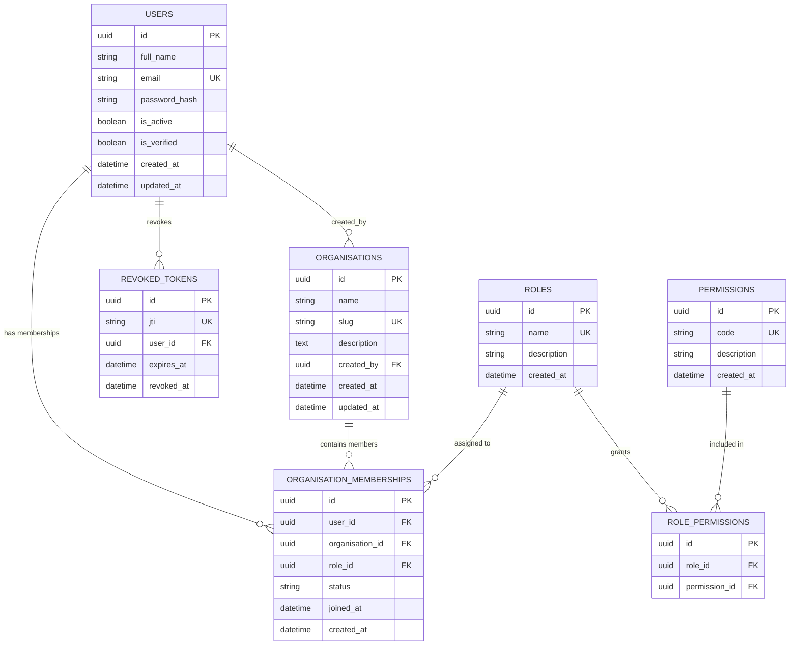
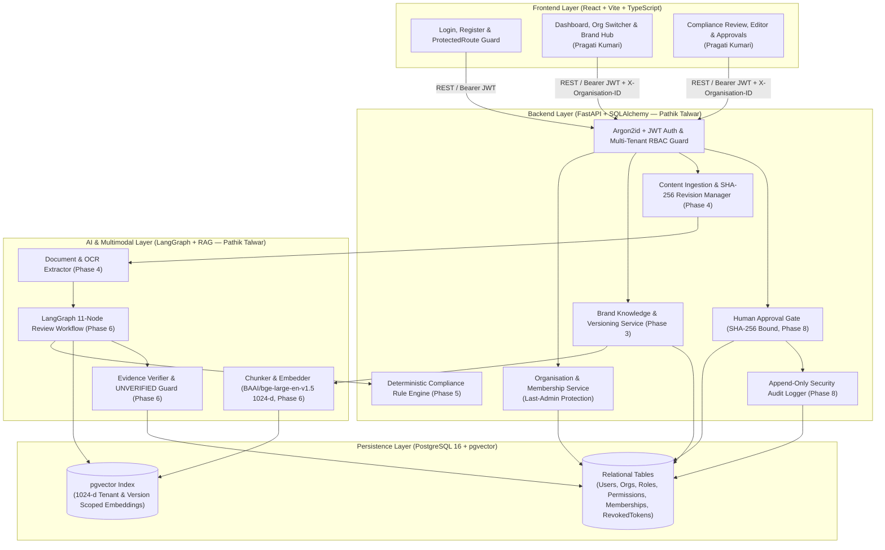

# Inkloom AI — System Architecture & Technical Design

## 1. Product Overview

**Inkloom AI** is an enterprise-grade, AI-powered Brand Compliance and Marketing Content Review Platform built for **CodeTitans India 2026 Round 2**.

Inkloom AI verifies submitted marketing content against an organisation's **versioned, approved Brand Knowledge Base** using a **Hybrid Compliance Engine** (Deterministic Rule Engine + RAG-Grounded LangGraph Semantic Engine) followed by a **Cryptographically Bound Human Approval Workflow**.

**Core Principle:** Every compliance finding must be traceable to an applicable rule, approved brand fact, or supporting evidence chunk. If sufficient approved evidence is unavailable, the system explicitly marks the finding as `UNVERIFIED` rather than fabricating citations or scores.

---

## 2. Technology Stack

| Layer | Technology | Purpose |
| :--- | :--- | :--- |
| **Frontend** | React 18, Vite 5, TypeScript 5, Tailwind CSS 3, Lucide React, React Router 6 | Enterprise SaaS interface, Auth & RBAC workspace management, compliance telemetry, highlighted editor, approval inbox |
| **Backend** | Python 3.13, FastAPI, Pydantic v2, SQLAlchemy 2.1, Alembic | REST API, Argon2id password hashing, JWT authentication, RBAC enforcement, tenant isolation, deterministic rule engine, SHA-256 approval gate |
| **Database & Vector Store** | PostgreSQL 16 + `pgvector` (with local dev SQLite fallback) | Relational storage with strict foreign keys, versioned Brand Kits, and 1024-d vector similarity search |
| **AI & Orchestration** | LangGraph, Structured LLM API, `BAAI/bge-large-en-v1.5` (1024 dimensions) | 11-node compliance review state graph, semantic & tone analysis, evidence verification |
| **Document & Image Processing** | PyMuPDF (`fitz`), `python-docx`, OCR engine | Multimodal text extraction preserving document structure and source character spans |
| **Infrastructure & Testing** | Docker Compose, `pytest`, `httpx`, Git | Containerised PostgreSQL + pgvector, automated backend & frontend verification |

---

## 3. Authentication, Security & Multi-Tenant RBAC Architecture (Phase 2)

### 3.1 Password Hashing & Token Strategy
- **Password Hashing**: Uses **Argon2id** (`argon2-cffi`) with OWASP-recommended parameters (`time_cost=2`, `memory_cost=65536` KiB, `parallelism=2`, `hash_len=32`, `salt_len=16`). Plaintext passwords are never logged or stored.
- **JWT Access Tokens**: Signed with `HS256` using `SECRET_KEY` from environment variables. Every token includes:
  - `sub` (User UUID)
  - `email` (Normalised email)
  - `iss` (`inkloom-ai-api`)
  - `iat` (Issued-at timestamp)
  - `exp` (Expiration timestamp)
  - `jti` (Unique UUID v4 token identifier)
  - `type` (`"access"`)
- **Immediate Logout Revocation**: Calling `POST /api/v1/auth/logout` stores the token's `jti` in the `revoked_tokens` table. Every authenticated request checks `revoked_tokens`, ensuring logged-out tokens are rejected immediately (`401 Unauthorized`).
- **Frontend Session Storage**: The React frontend stores the short-lived bearer token in `sessionStorage` (scoped to the browser tab session rather than persistent `localStorage`) and clears it immediately on logout or `401` expiration.

### 3.2 Multi-Tenant Data Isolation & IDOR Protection
- Every domain resource belongs to an `Organisation`.
- The backend never trusts an `organisation_id` from the frontend without verifying that the authenticated `User` holds an `ACTIVE` `OrganisationMembership` in that organisation (`resolve_organisation_membership` in [`backend/app/api/deps.py`](file:///c:/Users/Win-11/Desktop/My%20World/backend/app/api/deps.py)).
- Attempting to access or mutate another organisation's endpoints (`GET /organisations/{id}`, `PATCH /organisations/{id}`, `GET /organisations/{id}/members`, `PATCH/DELETE /members/{membership_id}`, or passing a foreign `X-Organisation-ID` header) returns `403 Forbidden`.
- All membership mutations are scoped by both `OrganisationMembership.id == membership_id` AND `OrganisationMembership.organisation_id == context.organisation.id`, preventing cross-tenant membership IDOR attacks.
- **Last Active ADMIN Protection**: `count_active_admins` prevents demoting or removing the sole active `ADMIN` of any organisation (`400 Bad Request`).

### 3.3 Predefined Roles & Permission Matrix

| Permission Code | Description | `ADMIN` | `BRAND_MANAGER` | `CONTENT_CREATOR` | `REVIEWER` |
| :--- | :--- | :---: | :---: | :---: | :---: |
| `users:read` | View organisation members and roles | ✅ | ✅ | ✅ | ✅ |
| `users:manage` | Invite, change roles, and remove members | ✅ | ❌ | ❌ | ❌ |
| `organisation:manage` | Update organisation profile and settings | ✅ | ❌ | ❌ | ❌ |
| `brand:read` | View Brand Kits, approved facts, and rules | ✅ | ✅ | ✅ | ✅ |
| `brand:manage` | Create, update, and publish Brand Kits & rules | ✅ | ✅ | ❌ | ❌ |
| `content:create` | Upload and create marketing content drafts | ✅ | ❌ | ✅ | ❌ |
| `content:edit` | Edit content drafts and apply suggestions | ✅ | ❌ | ✅ | ❌ |
| `content:review` | Run and inspect compliance reviews & evidence | ✅ | ✅ | ✅ | ✅ |
| `approval:decide` | Approve, reject, or request revisions | ✅ | ❌ | ❌ | ✅ |
| `audit:read` | View organisation security audit logs | ✅ | ❌ | ❌ | ❌ |

---

## 4. Phase 2 Database Entity Relationship Diagram (Implemented)

---

## 5. System Architecture Diagram

