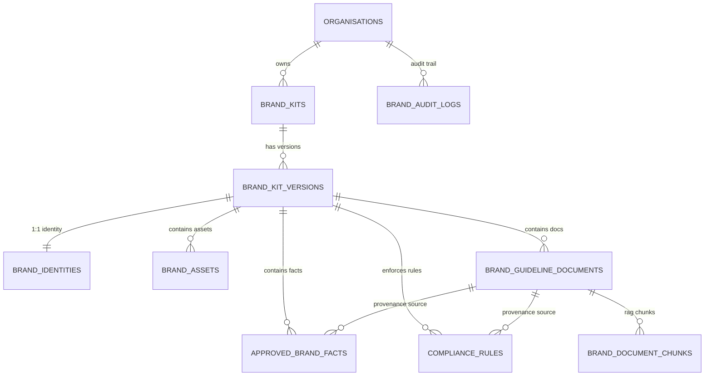

# Inkloom AI — Phase 3 Architecture & Implementation Plan: Brand Hub (Authoritative Reconciled Specification)

**Document Version:** 3.2 (Reconciled Authoritative Specification — Preserving Full `a0e0c84` Architectural Requirements + Stage 3.1 Nine-Table Schema)
**Target Milestone:** Phase 3 — Brand Hub (Persistent Multi-Tenant Versioned Brand Kits)  
**Baseline Checkpoint:** `0a57f49` (Phase 2 Approved Milestone) | `a0e0c84` (Phase 3 Conditionally Approved Plan)
**Target Environment:** FastAPI + PostgreSQL 16.15 + `pgvector` 0.8.7 + SQLAlchemy 2.1 + Alembic 1.20 + React 18 / TypeScript 5
**Status:** APPROVED — STAGE 3.1 DATABASE & MIGRATION `0003` IMPLEMENTED; RECONCILED FOR STAGE 3.2+

---

## Document Reconciliation & Architectural Change Note (v3.0 `a0e0c84` $\rightarrow$ v3.1 $\rightarrow$ v3.2)

### Why This Reconciliation Was Performed
During the Stage 3.1 implementation of the nine Brand Hub SQLAlchemy models and Alembic migration `0003_phase3_brand_hub`, `docs/PHASE3_BRAND_HUB_PLAN.md` was updated from v3.0 (Git commit `a0e0c84`, 695 lines) to v3.1 (382 lines) to document the nine-table normalized schema. However, the v3.1 edit shortened the file and inadvertently omitted critical approved sections from `a0e0c84`—specifically the Tenant-Scoped Query Helper definitions (Section 3), the complete Deterministic Version Lifecycle Q&A and Pre-Publish Validation Gates (Section 4), the File Upload Security & Two-Phase Staging Protocol (Section 6), the 23-endpoint REST API Contract (Section 8), and the 17-point Acceptance Criteria & Verification Test Plan (Section 9).

This v3.2 revision **reconciles both versions in full without shortening**:
1. **Preserves the authoritative Nine-Table Stage 3.1 Schema (`0003_phase3_brand_hub`)** and explicitly documents every structural evolution from the earlier six-table draft in `a0e0c84`.
2. **Restores 100% of the approved `a0e0c84` requirements** for Tenant Read/Write Isolation, Deterministic Version Lifecycle, Triple-Layer Immutability, File Upload Security & Two-Phase Staging, Reference-Counted File Deletion, REST API Contract, and Acceptance Criteria tests.
3. **Explicitly locks the Document-Processing & RAG Lifecycle:** All guideline document parsing, text chunk generation (`brand_document_chunks`), and `pgvector` `Vector(1024)` embedding must complete while a `BrandKitVersion` is in `DRAFT` status (`parsing_status = 'EMBEDDED'`). Publishing a `DRAFT` version strictly rejects any attached guideline document whose processing is incomplete (`PENDING`, `PROCESSING`, `PARSED`) or `FAILED`.

### Explicit Architectural Evolution: Six-Table Draft (`a0e0c84`) $\rightarrow$ Nine-Table Stage 3.1 Implementation
Where the earlier six-table specification in `a0e0c84` conflicted with the approved Stage 3.1 nine-table architecture, the nine-table schema is retained as authoritative:
1. **Separation of `brand_identities` (Table 3) from `brand_kit_versions` (Table 2):**
   - *In `a0e0c84` (6-table model):* Brand identity attributes (`brand_voice_summary`, `target_audience`, `dos_and_donts`, `logos_json`, `colours_json`, `typography_json`) were embedded directly as columns on `brand_kit_versions`.
   - *In Stage 3.1 (9-table model):* `brand_kit_versions` is a clean lifecycle & snapshot header table, while `brand_identities` is a dedicated 1-to-1 child table (`UNIQUE (brand_kit_version_id)`, composite FK `(brand_kit_version_id, organisation_id) -> brand_kit_versions(id, organisation_id)`) storing structured identity fields (`brand_name`, `tagline`, `mission_statement`, `brand_voice_tone`, `brand_voice_guidelines`, `preferred_vocabulary_json`, `prohibited_vocabulary_json`, `color_palette_json`, `typography_rules_json`, hex swatches, and font families).
2. **Addition of `brand_document_chunks` (Table 8) with `pgvector` `Vector(1024)`:**
   - *In `a0e0c84` (6-table model):* Only `brand_guideline_documents` was defined; RAG chunks were deferred.
   - *In Stage 3.1 (9-table model):* `brand_document_chunks` is created in migration `0003_phase3_brand_hub` with `embedding Vector(1024)` (`BAAI/bge-large-en-v1.5`), provenance offsets (`page_number`, `section_heading`, `char_start`, `char_end`, `content_sha256`, `token_count`), and a 3-column composite tenant foreign key `(document_id, brand_kit_version_id, organisation_id) -> brand_guideline_documents(id, brand_kit_version_id, organisation_id) ON DELETE CASCADE`.
3. **Addition of `brand_audit_logs` (Table 9):**
   - *In `a0e0c84` (6-table model):* Audit events were referenced generically against `audit_logs`.
   - *In Stage 3.1 (9-table model):* `brand_audit_logs` is a dedicated, append-only, tenant-scoped audit table (`organisation_id`, `actor_user_id`, `brand_kit_id`, `brand_kit_version_id`, `action`, `resource_type`, `resource_id`, `details_json`, `created_at`) protected against modification or deletion by PostgreSQL trigger `trg_validate_and_protect_brand_audit_logs`.
4. **Table & Column Naming Alignment on Facts and Rules (`approved_brand_facts` & `compliance_rules`):**
   - *In `a0e0c84`:* Named `brand_approved_facts` and `brand_compliance_rules`.
   - *In Stage 3.1:* Named `approved_brand_facts` (`ApprovedBrandFact`) and `compliance_rules` (`ComplianceRule`), with explicit provenance columns (`source_type`, `source_document_id`, `source_reference`, `evidence_excerpt`), structured numeric/currency fields (`currency`, `numeric_value`, `unit`), and human review governance columns (`approval_status`, `reviewed_by_user_id`, `reviewed_at`, `review_notes`, `effective_from`, `effective_to`).

---

## 1. Executive Summary & Architectural Principles

The **Brand Hub** is the authoritative source of brand truth for Inkloom AI's compliance and content review engine. Every content generation, deterministic rule evaluation (Phase 5), RAG semantic analysis (Phase 6), and cryptographically bound human approval workflow (Phase 8) must evaluate content against an **immutable, published `BrandKitVersion`** belonging to the active tenant (`Organisation`).

### Core Architectural Guarantees
1. **Complete Nine-Table Relational & Vector Schema:**
   - `brand_kits` — Top-level organisation-scoped Brand Kit container with active version pointer (`active_version_id`).
   - `brand_kit_versions` — Sequential version snapshots (`DRAFT -> PUBLISHED -> ARCHIVED`).
   - `brand_identities` — 1-to-1 versioned brand identity (voice, tone, mission, vocabulary, colour palette, typography).
   - `approved_brand_facts` — Structured ground-truth facts (pricing, specs, claims, currencies, numeric values) with full provenance and approval lifecycle (`PENDING_REVIEW`, `APPROVED`, `REJECTED`).
   - `compliance_rules` — Structured compliance rules (prohibited terms, mandatory disclaimers, restricted claims, regex/keyword patterns, priority, severity) with provenance and approval lifecycle.
   - `brand_assets` — Versioned media asset metadata (logos, icons, brand images, typography specs) with magic-byte MIME verification and SHA-256 checksums.
   - `brand_guideline_documents` — Versioned reference documents (PDF, DOCX, TXT, MD) with SHA-256 checksums and processing telemetry.
   - `brand_document_chunks` — RAG chunk table with `Vector(1024)` (`pgvector`) embeddings for `BAAI/bge-large-en-v1.5`.
   - `brand_audit_logs` — Append-only tenant-scoped audit trail for all Brand Hub lifecycle and governance actions.
2. **Triple-Layer Published & Archived Version Immutability:**
   - Once a `BrandKitVersion` transitions from `DRAFT` to `PUBLISHED` (or `ARCHIVED`), its identity, facts, compliance rules, assets, guideline document binaries, and document chunks cannot be modified or deleted through the API, ORM service layer, or direct SQL updates/deletes (enforced via PostgreSQL triggers raising SQLSTATE `23514` `check_violation` with diagnostic codes `[P0001]`–`[P0005]` and an explicit 10-column allowlist on `brand_guideline_documents` telemetry).
3. **Defense-in-Depth Tenant Read & Write Isolation:**
   - **Mandatory `TenantContext` on Every Read & Write:** Composite foreign keys enforce relational integrity on writes and joins, but **do not independently filter `SELECT` queries**. Every Brand Hub read, list, download, audit query, and write operation requires an authenticated `TenantContext` resolved via `get_path_tenant_context` / `require_permission` (`backend/app/api/deps.py:165-184`) and executes through mandatory tenant-scoped query helpers that append `WHERE <table>.organisation_id = :ctx_org_id`.
   - **Composite Tenant Foreign Keys:** Every child entity carries `organisation_id` and enforces a **composite foreign key** `(parent_id, organisation_id)` referencing the parent table's `(id, organisation_id)` unique key (and 3-column composite FK `(document_id, brand_kit_version_id, organisation_id)` on `brand_document_chunks`), plus database triggers on nullable cross-references (`active_version_id`, `source_document_id`, `brand_audit_logs`), making cross-organisation parent/child linking structurally impossible in PostgreSQL.
4. **Deterministic Version Concurrency & Lifecycle (`DRAFT -> PUBLISHED -> ARCHIVED`):**
   - Version creation, publishing, and archiving lock the parent `BrandKit` and target `BrandKitVersion` rows (`SELECT ... FOR UPDATE` with `populate_existing=True`), enforce `UNIQUE (brand_kit_id, version_number)` and a partial unique index `uq_brand_kit_single_draft` (`WHERE status = 'DRAFT'`, ensuring at most one active working draft per Brand Kit), and forbid restoring `ARCHIVED` versions (reusing an archived version requires cloning a new `DRAFT` version $N+1$).
5. **Pre-Publication Document Processing, Chunking & Embedding Completeness:**
   - Guideline document text extraction, chunk generation (`brand_document_chunks`), and `pgvector` `Vector(1024)` embedding generation must complete while the version is in `DRAFT` status (`parsing_status = 'EMBEDDED'`). Attempting to publish a `DRAFT` version with any guideline document in `PENDING`, `PROCESSING`, `PARSED`, or `FAILED` status is rejected with `422 Unprocessable Entity`.
6. **Hardened File Upload & Transactional Storage Consistency:**
   - Strict magic-byte signature verification (never trusting `Content-Type` headers alone), filename canonicalization, UUID storage keys, SVG script/event-handler sanitization, streaming SHA-256 checksums, two-phase staging-to-permanent promotion (`storage/.staging/{uuid}.part` $\rightarrow$ `os.replace`), rollback compensation, and reference-counted file retention across cloned versions.
7. **Phase 2 RBAC & Audit Continuity:**
   - Seamless integration with existing `PermissionCode.BRAND_READ` (`brand:read`), `PermissionCode.BRAND_MANAGE` (`brand:manage`), and `PermissionCode.AUDIT_READ` (`audit:read`) already seeded in `0001_phase2_auth_rbac.py`, verified idempotently in migration `0003_phase3_brand_hub`, and structured audit logging into `brand_audit_logs`.

---

## 2. Phase 2 RBAC Compatibility & Migration `0003` Specification

### 2.1 Inspection of Existing Phase 2 RBAC Implementation
Direct inspection of the Phase 2 codebase confirms the following exact implementation:

1. **Role & Permission Definitions (`backend/app/models/__init__.py:23-70`):**
   - `RoleName` defines `ADMIN = "ADMIN"`, `BRAND_MANAGER = "BRAND_MANAGER"`, `CONTENT_CREATOR = "CONTENT_CREATOR"`, and `REVIEWER = "REVIEWER"` (stored in `roles.name`).
   - `PermissionCode` already defines all required Brand Hub and Audit permissions:
     ```python
     class PermissionCode:
         USERS_READ = "users:read"
         USERS_MANAGE = "users:manage"
         ORGANISATION_MANAGE = "organisation:manage"
         BRAND_READ = "brand:read"       # Line 51
         BRAND_MANAGE = "brand:manage"   # Line 52
         CONTENT_CREATE = "content:create"
         CONTENT_EDIT = "content:edit"
         CONTENT_REVIEW = "content:review"
         APPROVAL_DECIDE = "approval:decide"
         AUDIT_READ = "audit:read"       # Line 57
     ```
2. **Role-Permission Matrix (`backend/app/models/__init__.py:73-105`):**
   `ROLE_PERMISSION_MATRIX` already maps `brand:read`, `brand:manage`, and `audit:read` across the four built-in `RoleName` values:
   - `RoleName.ADMIN` (`ADMIN`): includes `PermissionCode.BRAND_READ`, `PermissionCode.BRAND_MANAGE`, and `PermissionCode.AUDIT_READ`.
   - `RoleName.BRAND_MANAGER` (`BRAND_MANAGER`): includes `PermissionCode.BRAND_READ` and `PermissionCode.BRAND_MANAGE`.
   - `RoleName.CONTENT_CREATOR` (`CONTENT_CREATOR`): includes `PermissionCode.BRAND_READ` (read-only).
   - `RoleName.REVIEWER` (`REVIEWER`): includes `PermissionCode.BRAND_READ` (read-only).
3. **Database Seeding (`backend/alembic/versions/0001_phase2_auth_rbac.py:157-202`):**
   Migration `0001_phase2_auth_rbac` already inserts `("brand:read", "View Brand Kits, approved facts, and compliance rules")` and `("brand:manage", "Create, update, and publish Brand Kits and rules")` into `permissions` and binds them in `role_permissions`.
4. **Organisation Membership & RBAC Dependencies (`backend/app/api/deps.py:104-184`):**
   - `resolve_organisation_membership(db, user, organisation_id)` queries `OrganisationMembership` joined with `Organisation` and loads `OrganisationMembership.role -> Role.role_permissions`, rejecting missing/inactive memberships with `403 Forbidden` and returning a `TenantContext`.
   - `get_path_tenant_context(organisation_id: uuid.UUID = Path(...), ...)` resolves `TenantContext` directly from the `{organisation_id}` URL path parameter.
   - `require_permission(required_permission: str)` wraps `get_path_tenant_context` and raises `403 Forbidden ("Permission '{required_permission}' is required for this operation.")` if `required_permission not in context.permissions`.

### 2.2 How Migration `0003_phase3_brand_hub` Handles `brand:read` and `brand:manage`
Because `0001_phase2_auth_rbac` already created and mapped `brand:read`, `brand:manage`, and `audit:read`, migration `0003_phase3_brand_hub` (`down_revision = "0002_organisation_invitations"`) **never** drops, renames, replaces, or weakens any existing permissions or role mappings. Instead, `0003_phase3_brand_hub` executes an **idempotent verification & upsert step** during `upgrade()`:

```sql
-- Idempotently ensure all PermissionCode entries (including brand:read, brand:manage, audit:read) exist
INSERT INTO permissions (id, code, description, created_at)
SELECT :id, :code, :desc, :now
WHERE NOT EXISTS (SELECT 1 FROM permissions WHERE code = :code);

-- Idempotently ensure role_permissions mappings match ROLE_PERMISSION_MATRIX
INSERT INTO role_permissions (id, role_id, permission_id)
SELECT :id, r.id, p.id
FROM roles r
JOIN permissions p ON p.code = :pcode
WHERE r.name = :rname
  AND NOT EXISTS (
      SELECT 1 FROM role_permissions rp
      WHERE rp.role_id = r.id AND rp.permission_id = p.id
  );
```

- **Downgrade Safety (`downgrade()` in `0003_phase3_brand_hub`):** `downgrade()` drops **only** the Phase 3 triggers, trigger functions, constraints, and the nine Phase 3 tables (`brand_audit_logs`, `brand_document_chunks`, `brand_assets`, `compliance_rules`, `approved_brand_facts`, `brand_guideline_documents`, `brand_identities`, `brand_kit_versions`, `brand_kits`). It **never** deletes rows from `permissions`, `roles`, or `role_permissions`, preserving full Phase 2 RBAC state.

### 2.3 Endpoint Permission Matrix

| Operation Category | Required Dependency | Permitted Roles | Denied Roles (`403 Forbidden`) |
|---|---|---|---|
| Read Brand Kits, Versions, Identity, Facts, Rules, Assets, Documents, Chunks | `Depends(require_permission(PermissionCode.BRAND_READ))` | `ADMIN`, `BRAND_MANAGER`, `CONTENT_CREATOR`, `REVIEWER` | Non-members, `INVITED`/`SUSPENDED` members |
| Download Brand Asset or Guideline Document Binary | `Depends(require_permission(PermissionCode.BRAND_READ))` | `ADMIN`, `BRAND_MANAGER`, `CONTENT_CREATOR`, `REVIEWER` | Non-members, `INVITED`/`SUSPENDED` members |
| Create/Edit Draft, Update Identity, Manage Facts/Rules, Upload/Delete Files, Reparse Docs, Publish, Archive | `Depends(require_permission(PermissionCode.BRAND_MANAGE))` | `ADMIN`, `BRAND_MANAGER` | `CONTENT_CREATOR`, `REVIEWER`, non-members |
| Read Brand Hub Audit Events (`brand_audit_logs`) | `Depends(require_permission(PermissionCode.AUDIT_READ))` | `ADMIN` | `BRAND_MANAGER`, `CONTENT_CREATOR`, `REVIEWER`, non-members |

---

## 3. Tenant Read & Write Isolation Architecture

### 3.1 Why Composite Foreign Keys Are Necessary But Insufficient for Reads
Composite foreign keys (`FOREIGN KEY (parent_id, organisation_id) REFERENCES parent(id, organisation_id)`) guarantee at the database level that a child row in Tenant A can **never** be inserted or updated to reference a parent row in Tenant B. However, composite foreign keys **do not filter `SELECT` queries**. A naive query such as `db.get(BrandKit, kit_id)` or `select(BrandAsset).where(BrandAsset.id == asset_id)` would return Tenant A's record to Tenant B if `organisation_id` were omitted from the `WHERE` clause.

### 3.2 Mandatory `TenantContext` Enforcement for Every Read and Write Operation
To prevent cross-tenant reads, updates, deletes, and file downloads, Phase 3 enforces the following **non-negotiable query architecture**:

1. **Path-Scoped `TenantContext` Injection on Every Route:**
   Every Brand Hub route is mounted under `/api/v1/organisations/{organisation_id}/brand-kits...` and injects `context: TenantContext = Depends(require_permission(...))`. No route accepts `organisation_id` from a request body or query parameter.
2. **Ban on Unscoped `db.get()`:**
   Direct calls to `db.get(Model, entity_id)` are **prohibited** in `brand_service.py` and `brand_kits.py`.
3. **Mandatory Tenant-Scoped Loader Helpers in `brand_service.py`:**
   All database reads, updates, deletes, and downloads must resolve target entities through dedicated helpers that require `context: TenantContext` (or `organisation_id: uuid.UUID`) and include `Model.organisation_id == organisation_id` in every `WHERE` clause:

```python
def _get_brand_kit_or_404(
    db: Session,
    *,
    organisation_id: uuid.UUID,
    brand_kit_id: uuid.UUID,
    for_update: bool = False,
) -> BrandKit:
    stmt = select(BrandKit).where(
        BrandKit.id == brand_kit_id,
        BrandKit.organisation_id == organisation_id,
    )
    if for_update:
        stmt = stmt.with_for_update().execution_options(populate_existing=True)
    kit = db.scalars(stmt).first()
    if not kit:
        raise HTTPException(
            status_code=status.HTTP_404_NOT_FOUND,
            detail="Brand Kit not found in this organisation.",
        )
    return kit


def _get_version_or_404(
    db: Session,
    *,
    organisation_id: uuid.UUID,
    brand_kit_id: uuid.UUID,
    version_id: uuid.UUID,
    for_update: bool = False,
) -> BrandKitVersion:
    stmt = select(BrandKitVersion).where(
        BrandKitVersion.id == version_id,
        BrandKitVersion.brand_kit_id == brand_kit_id,
        BrandKitVersion.organisation_id == organisation_id,
    )
    if for_update:
        stmt = stmt.with_for_update().execution_options(populate_existing=True)
    version = db.scalars(stmt).first()
    if not version:
        raise HTTPException(
            status_code=status.HTTP_404_NOT_FOUND,
            detail="Brand Kit version not found in this organisation.",
        )
    return version


def _get_child_entity_or_404(
    db: Session,
    model_cls: type[T],
    *,
    organisation_id: uuid.UUID,
    brand_kit_version_id: uuid.UUID,
    entity_id: uuid.UUID,
) -> T:
    stmt = select(model_cls).where(
        model_cls.id == entity_id,
        model_cls.brand_kit_version_id == brand_kit_version_id,
        model_cls.organisation_id == organisation_id,
    )
    entity = db.scalars(stmt).first()
    if not entity:
        raise HTTPException(
            status_code=status.HTTP_404_NOT_FOUND,
            detail="Requested brand resource not found in this organisation.",
        )
    return entity
```

4. **Uniform `404 Not Found` on Cross-Tenant Resource Probes:**
   When an authenticated member of Organisation B requests a `brand_kit_id`, `version_id`, `fact_id`, `rule_id`, `asset_id`, or `doc_id` belonging to Organisation A under `/api/v1/organisations/{org_B_id}/...`, the tenant-scoped `WHERE organisation_id = :org_B_id` predicate returns `None` and raises `404 Not Found` (preventing cross-tenant UUID enumeration). When a user who is **not** a member of Organisation A requests `/api/v1/organisations/{org_A_id}/...`, `resolve_organisation_membership` raises `403 Forbidden` before any Brand Hub query runs.
5. **Asset & Document Download Isolation:**
   Binary download endpoints (`GET .../assets/{asset_id}/download` and `GET .../documents/{doc_id}/download`) first verify the parent `BrandKit` and `BrandKitVersion` via `_get_version_or_404(db, organisation_id=context.organisation.id, ...)` and then load the `BrandAsset` / `BrandGuidelineDocument` via `_get_child_entity_or_404(db, ..., organisation_id=context.organisation.id, ...)`. Furthermore, before opening the file on disk, the storage service verifies that the resolved canonical filesystem path resides strictly inside `{STORAGE_ROOT}/{context.organisation.id}/brand_kits/{brand_kit_id}/`.

### 3.3 Composite Tenant Foreign Keys & Cross-Reference Triggers in PostgreSQL
Every Brand Hub table stores `organisation_id UUID NOT NULL` and binds to its parent via composite tenant foreign keys and triggers:

```text
organisations (id)
  ├── brand_kits (id, organisation_id)  [UNIQUE (id, organisation_id)]
  │     ├── active_version_id -> FK (active_version_id) REFERENCES brand_kit_versions(id) ON DELETE SET NULL
  │     │     + Trigger trg_validate_brand_kit_active_version (enforces same brand_kit_id, same organisation_id, and status = 'PUBLISHED')
  │     └── brand_kit_versions (id, brand_kit_id, organisation_id)
  │           [FK (brand_kit_id, organisation_id) REFERENCES brand_kits(id, organisation_id) ON DELETE CASCADE]
  │           [UNIQUE (id, organisation_id)]
  │           [UNIQUE (id, brand_kit_id, organisation_id)]
  │           ├── brand_identities (brand_kit_version_id, organisation_id)          [1:1 UNIQUE (brand_kit_version_id)]
  │           ├── approved_brand_facts (brand_kit_version_id, organisation_id)      [+ Trigger validates source_document_id tenant & version]
  │           ├── compliance_rules (brand_kit_version_id, organisation_id)          [+ Trigger validates source_document_id tenant & version]
  │           ├── brand_assets (brand_kit_version_id, organisation_id)
  │           └── brand_guideline_documents (id, brand_kit_version_id, organisation_id)
  │                 [UNIQUE (id, brand_kit_version_id, organisation_id)]
  │                 └── brand_document_chunks (document_id, brand_kit_version_id, organisation_id)
  │                       [3-Column Composite FK REFERENCES brand_guideline_documents(id, brand_kit_version_id, organisation_id)]
  └── brand_audit_logs (id, organisation_id, brand_kit_id, brand_kit_version_id)
        [+ Trigger trg_validate_and_protect_brand_audit_logs validates same-tenant/same-kit references & append-only lock]
```

**Why Nullable Cross-References Use `ON DELETE SET NULL` + Triggers:**
For nullable cross-references (`brand_kits.active_version_id`, `approved_brand_facts.source_document_id`, `compliance_rules.source_document_id`, and `brand_audit_logs.brand_kit_id` / `brand_kit_version_id`), standard SQL `MATCH SIMPLE` composite foreign keys with `ON DELETE SET NULL` either skip validation when one nullable sibling column is `NULL` (e.g., kit-level audit logs where `brand_kit_version_id IS NULL`) or attempt to null out `NOT NULL` columns (`organisation_id`, `brand_kit_version_id`) when the referenced target is deleted. Pairing `ON DELETE SET NULL` single-column FKs with PostgreSQL `BEFORE INSERT OR UPDATE` triggers (`trg_validate_brand_kit_active_version`, `trg_enforce_approved_brand_facts_immutability`, `trg_enforce_compliance_rules_immutability`, `trg_validate_and_protect_brand_audit_logs`) guarantees both clean `SET NULL` cascades on draft deletion and strict `SQLSTATE 23503` (`[P0004]`) rejection of any cross-tenant or cross-version reference.

### 3.4 PostgreSQL Row-Level Security (RLS) Evaluation & Connection-Pooling Safety
- **Why Naive RLS is Dangerous with Connection Pooling:**
  SQLAlchemy's default `QueuePool` reuses PostgreSQL connections across requests. Executing session-scoped `SET app.current_organisation_id = '...'` leaks tenant state to subsequent requests if a connection is returned to the pool without `RESET ALL`, or if a background task shares the connection. Additionally, if the PostgreSQL connection user is the table owner (or has `BYPASSRLS`), RLS policies are silently bypassed unless `FORCE ROW LEVEL SECURITY` is enabled.
- **Architectural Decision for Phase 3:**
  1. **Primary Mandatory Control (Enforced in Phase 3):** Application-level `TenantContext` dependency injection + mandatory tenant-scoped query helpers (`WHERE organisation_id = :org_id`) + Database-level Composite Tenant Foreign Keys (`(parent_id, organisation_id)`) and cross-tenant triggers. This matches Phase 2 (`OrganisationMembership`, `OrganisationInvitation`) and has zero connection-pool state hazards.
  2. **Safe Pattern if PostgreSQL RLS is Enabled (Transaction-Scoped `SET LOCAL`):**
     If PostgreSQL RLS is layered in the future, it **must never** use session-level `SET`. It must use `SET LOCAL app.current_organisation_id = :org_id` inside `get_path_tenant_context` (which PostgreSQL automatically scopes to the current transaction and clears on `COMMIT` or `ROLLBACK`) paired with `current_setting('app.current_organisation_id', true)::uuid`. Because the application connects as the schema owner in standard single-role deployments, Phase 3 does not rely on RLS for tenant isolation and instead enforces explicit `organisation_id` predicates verified by dedicated cross-tenant integration tests.

---

## 4. Deterministic Version Lifecycle, Document Processing Lifecycle & Active Version Semantics

### 4.1 State Machine (`DRAFT -> PUBLISHED -> ARCHIVED`)

```text
                     ┌────────────────────────────────────────────────────────┐
                     │  Clones new DRAFT (version_number = MAX + 1) from      │
                     │  active PUBLISHED version or selected source version   │
                     ▼                                                        │
[Create Brand Kit] ──► [ DRAFT (v1) ] ──(Publish)──► [ PUBLISHED (v1) ] ──────┼──(Archive or Superseded)──► [ ARCHIVED (v1) ]
                         │  ▲                          │                      │                               (Terminal State)
                         └──┘                          └──────────────────────┴──────────────────────────────►(Clone into vN+1)
                     (Mutable in place;            (Strictly Immutable)                                   (Strictly Immutable)
                      Docs parsed, chunked
                      & embedded here)
```

### 4.2 Explicit Lifecycle Answers & Invariants

1. **Can an `ARCHIVED` version ever be restored to `PUBLISHED` or `DRAFT`?**
   - **No.** `ARCHIVED` is a **terminal state**. Both the service layer (`brand_service.py`) and the PostgreSQL trigger (`trg_enforce_brand_kit_version_immutability`) strictly forbid transitioning `ARCHIVED -> PUBLISHED` or `ARCHIVED -> DRAFT` (`[P0003]`, `SQLSTATE 23514`).
   - **How to reuse an archived version:** An `ADMIN` or `BRAND_MANAGER` invokes `POST /api/v1/organisations/{org_id}/brand-kits/{kit_id}/versions` with `{"source_version_id": "<archived_version_uuid>"}`. This creates a brand-new mutable `DRAFT` version ($N + 1$) deep-cloned from the archived version, preserving an unbroken, append-only audit and version history.

2. **How does `brand_kits.active_version_id` change during publishing? (Required Stage 3.2/3.3 Atomic Publish Contract)**
   - Every `BrandKit` has at most **one** `PUBLISHED` version at any point in time, enforced at the database layer by partial unique index `uq_brand_kit_single_published` (`UNIQUE (brand_kit_id) WHERE status = 'PUBLISHED'`, added in migration `0004_single_published_version`) and referenced by `brand_kits.active_version_id`.
   - Because PostgreSQL evaluates `uq_brand_kit_single_published` per statement, **the Stage 3.2/3.3 publish service must archive and flush the previous `PUBLISHED` version before promoting the new `DRAFT` version**, inside a single transaction under a parent `BrandKit` row lock:
     1. The transaction acquires row locks (`SELECT ... FOR UPDATE` with `populate_existing=True`) on the parent `BrandKit` row first, and then on the target `DRAFT` `BrandKitVersion` row $V_{\text{new}}$.
     2. If an existing `PUBLISHED` version $V_{\text{old}}$ exists for this `brand_kit_id` (loaded via `FOR UPDATE`), the transaction **first transitions $V_{\text{old}}$ from `PUBLISHED` to `ARCHIVED` and calls `db.flush()`** (setting `V_old.status = 'ARCHIVED'`, `V_old.archived_at = now`, `V_old.archived_by_user_id = current_user.id`, which also clears `brand_kit.active_version_id = NULL` via trigger `fn_enforce_brand_kit_version_immutability` and removes $V_{\text{old}}$ from `uq_brand_kit_single_published`).
     3. The transaction then transitions $V_{\text{new}}$ from `DRAFT` to `PUBLISHED` (`V_new.status = 'PUBLISHED'`, `V_new.published_at = now`, `V_new.published_by_user_id = current_user.id`) and calls `db.flush()`.
     4. The transaction updates `brand_kit.active_version_id = V_new.id` and `brand_kit.updated_at = now` (validated by `trg_validate_brand_kit_active_version`) and commits.
   - **Result:** At any instant, a `BrandKit` has at most one `PUBLISHED` version (enforced by `uq_brand_kit_single_published` and referenced by `brand_kit.active_version_id`), at most one `DRAFT` version (enforced by partial unique index `uq_brand_kit_single_draft`), and zero or more historical `ARCHIVED` versions.

3. **What happens when the currently active `PUBLISHED` version is explicitly archived?**
   - When an administrator calls `POST .../versions/{ver_id}/archive` on a `PUBLISHED` version:
     1. The transaction locks `BrandKit` and `BrandKitVersion` (`FOR UPDATE` with `populate_existing=True`).
     2. If `version.status != 'PUBLISHED'`, it raises `409 Conflict` (`"Only PUBLISHED versions can be archived."`).
     3. It transitions `version.status = 'ARCHIVED'`, `version.archived_at = now`, `version.archived_by_user_id = current_user.id`.
     4. Both the service layer and the PostgreSQL trigger (`fn_enforce_brand_kit_version_immutability`, lines 881–884) ensure that if `brand_kit.active_version_id == version.id`, `brand_kit.active_version_id` is atomically set to `NULL`.
   - **Downstream Impact:** When `brand_kit.active_version_id IS NULL`, no new content compliance review can be started against that Brand Kit until a new draft is published; however, all historical compliance reviews that recorded `brand_kit_version_id = version.id` retain full read access to that immutable `ARCHIVED` snapshot.

4. **How is a new `DRAFT` cloned?**
   - When `POST /api/v1/organisations/{org_id}/brand-kits/{kit_id}/versions` is called:
     1. The service locks the parent `BrandKit` row (`SELECT ... FOR UPDATE` with `populate_existing=True`).
     2. It checks whether a `DRAFT` version already exists for this `brand_kit_id`. If so, it raises `409 Conflict` (`"A draft version already exists for this Brand Kit."`).
     3. **Source Version Selection:**
        - If `payload.source_version_id` (or `cloned_from_version_id`) is provided, it loads that version via `_get_version_or_404(db, organisation_id=org_id, brand_kit_id=kit_id, version_id=payload.source_version_id)` (guaranteeing same Brand Kit and same Organisation).
        - Otherwise, if `brand_kit.active_version_id` is set, it uses the active `PUBLISHED` version as the clone source.
        - Otherwise, it selects the highest `version_number` version for that `brand_kit_id` (if any exists).
     4. **Next Version Number Calculation:** `next_ver = COALESCE(MAX(version_number), 0) + 1` under the `BrandKit` row lock.
     5. **Deep Copy of Snapshot Data Across Child Tables:**
        - Clones the 1:1 `BrandIdentity` row (`brand_identities`) into the new `DRAFT` `brand_kit_version_id`.
        - Clones all `ApprovedBrandFact` rows (`approved_brand_facts`) where `approval_status == 'APPROVED'` (assigning new `id`s and pointing to the new `DRAFT` `brand_kit_version_id`).
        - Clones all `ComplianceRule` rows (`compliance_rules`) where `approval_status == 'APPROVED'` (assigning new `id`s and pointing to the new `DRAFT` `brand_kit_version_id`).
        - Clones all `BrandAsset` (`brand_assets`) and `BrandGuidelineDocument` (`brand_guideline_documents`) rows (assigning new `id`s, mapping old `document_id -> new_document_id` on `source_document_id` references, referencing the same immutable content-addressed/UUID `storage_path` and `file_sha256`, and preserving `parsing_status`, `raw_text_content`, and `BrandDocumentChunk` rows (`brand_document_chunks`) so already-parsed and embedded documents do not require redundant re-parsing).

5. **How are concurrent draft creation and concurrent publishing requests handled?**
   - **Concurrent Draft Creation:** Both transactions attempt `SELECT ... FROM brand_kits WHERE id = :kit_id AND organisation_id = :org_id FOR UPDATE`. Transaction B blocks until Transaction A commits. When Transaction B resumes, `populate_existing=True` refreshes state, the check for an existing `DRAFT` sees Transaction A's newly committed `DRAFT`, and Transaction B cleanly returns `409 Conflict`. Even if bypassed, `uq_brand_kit_single_draft` (`UNIQUE (brand_kit_id) WHERE status = 'DRAFT'`) and `uq_brand_kit_version_number` (`UNIQUE (brand_kit_id, version_number)`) catch any race condition and map `IntegrityError` to `409 Conflict`.
   - **Concurrent Publishing:** Both transactions acquire `FOR UPDATE` on `BrandKit` and `BrandKitVersion` in deterministic order (`BrandKit` first, then `BrandKitVersion`). Transaction A transitions the version from `DRAFT` to `PUBLISHED` and commits. Transaction B unblocks, refreshes the row (`populate_existing=True`), sees `version.status == 'PUBLISHED'`, and immediately raises `409 Conflict ("Brand Kit version is already PUBLISHED and cannot be published again.")`.

### 4.3 Chosen Document-Processing Lifecycle & Pre-Publish Validation Gates

#### Authoritative Document-Processing Lifecycle (Pre-Publication Completion Rule)
1. **Upload & Processing in `DRAFT` Only:**
   - Guideline documents (`BrandGuidelineDocument`) can only be uploaded, deleted, or re-parsed while their parent `BrandKitVersion` is in `DRAFT` status.
   - During `DRAFT`, the document progresses through:
     `PENDING` $\rightarrow$ `PROCESSING` $\rightarrow$ `PARSED` (text extracted & deterministic `BrandDocumentChunk` rows inserted into `brand_document_chunks`) $\rightarrow$ `EMBEDDED` (1024-dimensional `BAAI/bge-large-en-v1.5` embeddings populated on `brand_document_chunks.embedding` and `embedded_at` recorded on `brand_guideline_documents`).
   - If text extraction, chunking, or embedding fails, `parsing_status` transitions to `FAILED` with `last_error_code` and `last_error_message` populated, and an `ADMIN` or `BRAND_MANAGER` can either invoke `POST .../documents/{doc_id}/reparse` or delete the failed document from the `DRAFT`.
2. **Why Parsing, Chunking, and Embedding Must Complete Before Publication:**
   - Once a `BrandKitVersion` is `PUBLISHED`, downstream compliance reviews (Phase 5 & Phase 6) immediately query `brand_document_chunks` for RAG evidence retrieval, and `trg_enforce_brand_document_chunks_immutability` strictly locks `brand_document_chunks` against any `INSERT`, `UPDATE`, or `DELETE` on `PUBLISHED` and `ARCHIVED` versions (`[P0002]`).
   - Therefore, **all document parsing, chunk generation, and vector embedding must complete before a version can transition from `DRAFT` to `PUBLISHED`**.
   - Note on `brand_guideline_documents` Trigger Allowlist: While `fn_enforce_guideline_doc_immutability()` maintains a defense-in-depth column allowlist permitting telemetry metadata updates at the database level (`parsing_status`, `parse_attempt_count`, `last_error_code`, `last_error_message`, `page_count`, `raw_text_content`, `embedding_model`, `embedding_model_version`, `parsed_at`, `embedded_at`) while locking all 14 binary identity/ownership columns, the application service layer (`publish_brand_kit_version()`) enforces that no version is published until every attached document has completed processing and chunk embedding.

#### Pre-Publish Validation Gates (`publish_brand_kit_version()`)
Before a `DRAFT` version can transition to `PUBLISHED`, `publish_brand_kit_version()` validates in order:
1. **Draft Status Gate:** `version.status == BrandKitVersionStatus.DRAFT` (else `409 Conflict`).
2. **Minimum Brand Identity & Content Gate:** A `BrandIdentity` row exists for the version (or at least one approved fact or compliance rule is configured; if completely empty, raises `422 Unprocessable Entity`).
3. **Zero Unapproved Facts & Rules Gate:** Queries `approved_brand_facts` and `compliance_rules` for `brand_kit_version_id == version.id` where `approval_status != 'APPROVED'`. If any `PENDING_REVIEW` or `REJECTED` facts or rules exist, raises `422 Unprocessable Entity` (`"Cannot publish Brand Kit version while unapproved or rejected facts or rules exist. Approve or delete pending items before publishing."`).
4. **Mandatory Document Processing, Chunking & Embedding Completion Gate:**
   - Queries all `BrandGuidelineDocument` rows for `brand_kit_version_id == version.id`.
   - If any document has `parsing_status` in `('PENDING', 'PROCESSING', 'PARSED', 'FAILED')` (i.e., not `'EMBEDDED'` / `'COMPLETED'`), or has zero corresponding rows in `brand_document_chunks`, `publish_brand_kit_version()` **rejects publication with `422 Unprocessable Entity`** (`"Cannot publish Brand Kit version while guideline documents have incomplete or failed processing. All documents must finish parsing, chunking, and embedding before publication."`).
5. **On-Disk Binary Integrity Gate:** Verifies that every attached `BrandAsset` and `BrandGuidelineDocument` file exists on disk (`final_path.is_file()`) and has a valid 64-character `file_sha256`. If any file is missing on disk, raises `422 Unprocessable Entity`.

---

## 5. Triple-Layer Immutability & PostgreSQL Trigger Specification

### 5.1 Layer 1 & Layer 2: API Design and Service Guard (`assert_version_is_draft`)
Every mutation function in `backend/app/services/brand_service.py` (updating `BrandIdentity`, creating/updating/deleting `ApprovedBrandFact` or `ComplianceRule`, uploading/deleting `BrandAsset` or `BrandGuidelineDocument`, or re-parsing documents) begins by locking the parent `BrandKitVersion` row (`FOR UPDATE` with `populate_existing=True`) and calling:

```python
def assert_version_is_draft(version: BrandKitVersion) -> None:
    if version.status != BrandKitVersionStatus.DRAFT:
        raise HTTPException(
            status_code=status.HTTP_409_CONFLICT,
            detail=(
                f"Brand Kit version {version.version_number} is {version.status} "
                "and is strictly immutable. Create a new draft version to make changes."
            ),
        )
```

### 5.2 Layer 3: Five PostgreSQL Trigger Functions (`0003_phase3_brand_hub.py`)
Migration `0003_phase3_brand_hub` installs five PostgreSQL `PL/pgSQL` trigger functions using standard SQLSTATE `23514` (`check_violation`) and `23503` (`foreign_key_violation`) paired with structured diagnostic codes (`[P0001]`–`[P0005]`):

#### Trigger Function 1: `fn_validate_brand_kit_active_version()` (`trg_validate_brand_kit_active_version` on `brand_kits`)
- Fires `BEFORE INSERT OR UPDATE OF active_version_id, organisation_id ON brand_kits`.
- When `NEW.active_version_id IS NOT NULL`, queries `SELECT brand_kit_id, organisation_id, status FROM brand_kit_versions WHERE id = NEW.active_version_id`.
- If `v_kit_id <> NEW.id OR v_org_id <> NEW.organisation_id`, raises `SQLSTATE 23503` (`[P0004] active_version_id must belong to the same brand_kit_id and organisation_id`).
- If `v_status <> 'PUBLISHED'`, raises `SQLSTATE 23514` (`[P0003] active_version_id on brand_kits must reference a PUBLISHED BrandKitVersion`).

#### Trigger Function 2: `fn_enforce_brand_kit_version_immutability()` (`trg_enforce_brand_kit_version_immutability` on `brand_kit_versions`)
- **Blocks `DELETE`** when `OLD.status IN ('PUBLISHED', 'ARCHIVED')` (unless the parent `Organisation` itself is being cascade-deleted) (`[P0001]`, `SQLSTATE 23514`).
- **Blocks modifying structural ownership columns** (`id`, `brand_kit_id`, `organisation_id`, `version_number`) in any state (`[P0001]`, `SQLSTATE 23514`).
- **Strictly Enforces State Transitions:**
  - `DRAFT -> ARCHIVED` is rejected (`[P0003]`, `SQLSTATE 23514`: a draft must be published before archiving, or deleted if abandoned).
  - `ARCHIVED` is terminal: **all** `UPDATE` operations on an `ARCHIVED` version are rejected (`[P0003]`, `SQLSTATE 23514`).
  - `PUBLISHED` may only transition to `ARCHIVED` (`NEW.status = 'ARCHIVED'`), and only when all snapshot columns (`changelog`, `cloned_from_version_id`, `created_by_user_id`, `published_by_user_id`, `published_at`, `created_at`) satisfy `NEW.<col> IS NOT DISTINCT FROM OLD.<col>` (`[P0001]`, `SQLSTATE 23514`).
  - Automatically sets `NEW.published_at := NOW()` on `DRAFT -> PUBLISHED` and `NEW.archived_at := NOW()` on `PUBLISHED -> ARCHIVED`, and automatically clears `brand_kits.active_version_id = NULL` when the active version transitions to `ARCHIVED`.

#### Trigger Function 3: `fn_enforce_brand_version_child_immutability()` (5 Triggers on `brand_identities`, `approved_brand_facts`, `compliance_rules`, `brand_assets`, `brand_document_chunks`)
- Queries `SELECT status FROM brand_kit_versions WHERE id = target_version_id` (and checks `OLD.brand_kit_version_id` on `UPDATE` if `brand_kit_version_id` is changed).
- If parent `status IN ('PUBLISHED', 'ARCHIVED')`, **rejects all `INSERT`, `UPDATE`, and `DELETE` operations unconditionally** (`[P0002]`, `SQLSTATE 23514`), except cascade `DELETE` when the parent `Organisation` is deleted.
- On `INSERT` or `UPDATE` of `approved_brand_facts` and `compliance_rules`, when `NEW.source_document_id IS NOT NULL`, verifies that `NEW.source_document_id` exists in `brand_guideline_documents` with the exact same `brand_kit_version_id` and `organisation_id` (`[P0004]`, `SQLSTATE 23503`).

#### Trigger Function 4: `fn_enforce_guideline_doc_immutability()` (`trg_enforce_guideline_doc_immutability` on `brand_guideline_documents`, updated in `0005_guideline_doc_reassignment`)
- On `UPDATE` when `NEW.brand_kit_version_id IS DISTINCT FROM OLD.brand_kit_version_id`, checks `OLD.brand_kit_version_id` first and rejects moving a guideline document away from a `PUBLISHED` or `ARCHIVED` parent version into any other version (including a `DRAFT` version) (`[P0002]`, `SQLSTATE 23514`).
- Locking matrix when target parent `BrandKitVersion.status IN ('PUBLISHED', 'ARCHIVED')`:

| Column Category | Exact Column Names on `brand_guideline_documents` | Permitted When Parent `status != 'DRAFT'`? |
|---|---|---|
| **Strictly Locked Identity & Ownership Columns (14 Columns)** | `id`, `brand_kit_version_id`, `organisation_id`, `title`, `document_category`, `original_filename`, `stored_filename`, `storage_backend`, `storage_path`, `mime_type`, `file_size_bytes`, `file_sha256`, `uploaded_by_user_id`, `created_at` | **NO** (Trigger raises `[P0002]` / `SQLSTATE 23514` on any modification; `INSERT` and `DELETE` are also completely blocked) |
| **Allowlisted Processing Telemetry Columns (10 Columns)** | `parsing_status`, `parse_attempt_count`, `last_error_code`, `last_error_message`, `page_count`, `raw_text_content`, `embedding_model`, `embedding_model_version`, `parsed_at`, `embedded_at` | **YES** (Permitted at DB trigger level on `UPDATE` **only** if all 14 locked columns above satisfy `NEW.<col> IS NOT DISTINCT FROM OLD.<col>`; note that service-level pre-publish validation requires parsing, chunking, and embedding to complete in `DRAFT` prior to publication) |

#### Trigger Function 5: `fn_validate_and_protect_brand_audit_logs()` (`trg_validate_and_protect_brand_audit_logs` on `brand_audit_logs`)
- On `INSERT`:
  - If `NEW.brand_kit_id IS NOT NULL`, verifies `EXISTS (SELECT 1 FROM brand_kits WHERE id = NEW.brand_kit_id AND organisation_id = NEW.organisation_id)` (`[P0004]`, `SQLSTATE 23503`).
  - If `NEW.brand_kit_version_id IS NOT NULL`, verifies `EXISTS (SELECT 1 FROM brand_kit_versions WHERE id = NEW.brand_kit_version_id AND organisation_id = NEW.organisation_id AND (NEW.brand_kit_id IS NULL OR brand_kit_id = NEW.brand_kit_id))` (`[P0004]`, `SQLSTATE 23503`).
- On `DELETE`: blocks all deletes unless the owning `Organisation` is being cascade-deleted (`[P0005]`, `SQLSTATE 23514`).
- On `UPDATE`: blocks all updates except `ON DELETE SET NULL` of `brand_kit_id` / `brand_kit_version_id` when a draft version or kit is deleted (`[P0005]`, `SQLSTATE 23514`).

### 5.3 ORM `Session.before_flush` Immutability Listener & Separation of Responsibilities
- **ORM Defence-in-Depth Safeguard (`_enforce_brand_hub_immutability_before_flush` in `backend/app/models/brand.py`):**
  - Enforces `BrandKitVersion` lifecycle/structural immutability (`[P0001]`, `[P0003]`), version-scoped child `INSERT`/`UPDATE`/`DELETE`/reassignment protection across all six child models (`[P0002]`, including the 10-field `BrandGuidelineDocument` telemetry allowlist), and `BrandAuditLog` append-only protection (`[P0005]`) at the SQLAlchemy ORM session flush layer (including in SQLite unit tests).
  - When a persistent ORM object's attributes are expired or deferred prior to modification (so `history.deleted` is empty), the listener recovers the original persisted row by primary key inside `with session.no_autoflush:` without triggering relationship lazy loads or substituting the newly assigned value.
- **Authoritative Role of PostgreSQL Triggers:**
  - PostgreSQL triggers (`0003_phase3_brand_hub` and `0005_guideline_doc_reassignment`) remain the authoritative enforcement layer for raw SQL, SQLAlchemy Core DML (`update`/`delete`/`insert`), and external database clients.
  - The ORM `before_flush` listener is not claimed to reproduce PostgreSQL-generated timestamps (`published_at`, `archived_at`), automatic `brand_kits.active_version_id` clearing on archive, or all database-level composite foreign-key and cross-tenant reference validations (`[P0004]`).

---

## 6. File Upload Security & Database/Filesystem Consistency Protocol

### 6.1 Upload Validation & Sanitization Pipeline (`backend/app/services/storage_service.py`)
1. **Extension & Magic-Byte Allowlist:**
   - **Brand Assets (`PRIMARY_LOGO`, `SECONDARY_LOGO`, `ICON`, `BRAND_IMAGE`, `TYPOGRAPHY_SPEC`):**
     - `.png`: magic bytes `\x89PNG\r\n\x1a\n` (`image/png`) — max `10 MB` (`10,485,760` bytes)
     - `.jpg` / `.jpeg`: magic bytes `\xff\xd8\xff` (`image/jpeg`) — max `10 MB` (`10,485,760` bytes)
     - `.webp`: magic bytes `RIFF....WEBP` (`image/webp`) — max `10 MB` (`10,485,760` bytes)
     - `.svg`: validated via `defusedxml` (no `<!DOCTYPE>`, `<!ENTITY>`, `<script>`, `<foreignObject>`, `onload`/`onerror` `on*` attributes, or `javascript:`/`data:` URIs) (`image/svg+xml`) — max `2 MB`
     - `.ttf` (`\x00\x01\x00\x00`), `.otf` (`OTTO`), `.woff` (`wOFF`), `.woff2` (`wOF2`) — max `10 MB` (`10,485,760` bytes, matching `ck_brand_assets_file_size_range`)
   - **Brand Guideline Documents (`STYLE_GUIDE`, `PRODUCT_CATALOG`, `LEGAL_POLICY`, `TONE_PLAYBOOK`, `BRAND_BOOK`):**
     - `.pdf`: magic bytes `%PDF-` (`application/pdf`) — max `25 MB` (`26,214,400` bytes)
     - `.docx`: ZIP header `PK\x03\x04` containing `word/document.xml` with zero `..` path entries — max `25 MB` (`26,214,400` bytes)
     - `.txt` / `.md`: strict UTF-8 decoding with zero `\x00` null bytes — max `5 MB`
2. **Filename Canonicalization & Storage Path Construction:**
   - Display filename (`original_filename`): strip directory components (`PurePath(raw).name`), reject null bytes or `..`, strip control characters, limit to 255 chars.
   - Disk filename (`stored_filename`): `{uuid4().hex}.{validated_ext}` (user filenames are **never** used in filesystem paths).
   - Relative storage path (`storage_path`): `{organisation_id}/brand_kits/{brand_kit_id}/{assets|documents}/{uuid4().hex}.{ext}`.
   - Path containment assertion: `resolved_target.resolve().is_relative_to(STORAGE_ROOT.resolve())` is checked before every write, read, or unlink.

### 6.2 Two-Phase Staging, Atomic Promotion & Rollback Compensation
To prevent partial writes, orphaned files on failed DB commits, or database rows pointing to missing files:

1. **Phase 1 — Stream to Staging (`storage/.staging/{staging_uuid}.part`):**
   - Stream upload in `64 KB` chunks to `{STORAGE_ROOT}/.staging/{staging_uuid}.part`.
   - Enforce byte limit during streaming; if exceeded, close and unlink the `.part` file immediately and raise `413 Content Too Large`.
   - Compute `hashlib.sha256()` incrementally while streaming.
   - Validate magic bytes / SVG safety / DOCX structure on the staged file. If invalid, unlink `.part` and raise `415 Unsupported Media Type` or `422 Unprocessable Entity`.
   - Flush and `os.fsync(fd)` the staging file.
2. **Phase 2 — Database Transaction & Atomic Promotion (`os.replace`):**
   - Acquire `FOR UPDATE` lock on the target `DRAFT` `BrandKitVersion` row.
   - Insert the `BrandAsset` or `BrandGuidelineDocument` row and call `db.flush()` so all DB constraints (`FK`, `CHECK`, triggers) are validated before touching the final storage directory.
   - Promote the staged file atomically into its final destination using `os.replace(staging_path, final_path)` (atomic on POSIX and Windows NTFS within the same volume).
   - If uploading a `BrandGuidelineDocument`, execute document text extraction, deterministic chunking (`BrandDocumentChunk`), and `Vector(1024)` embedding generation (updating `parsing_status = 'EMBEDDED'`, `page_count`, `raw_text_content`, `parsed_at`, `embedded_at`, or recording `parsing_status = 'FAILED'` with error details if parsing fails).
   - Call `db.commit()`.
3. **Phase 3 — Database Commit Failure Recovery (Compensation):**
   - If `db.flush()` or `db.commit()` raises any exception:
     - Execute `db.rollback()`.
     - In the `except` block, safely unlink both `staging_path` (if still present) and `final_path` (`Path.unlink(missing_ok=True)`), ensuring **zero orphaned files** remain on disk when a database transaction fails.

### 6.3 Reference-Counted File Deletion Across Cloned Versions
Because cloning a `BrandKitVersion` (`v1 -> v2`) clones `BrandAsset` and `BrandGuidelineDocument` metadata rows that reference the same underlying immutable `storage_path`, deleting an asset or document from a `DRAFT` version (`v2`) **must not** delete the physical file on disk if `v1` (or any other version) still references that `storage_path`!

**Mandatory Reference-Count Deletion Protocol:**
1. Verify parent `BrandKitVersion` is `DRAFT` (`assert_version_is_draft`).
2. Delete the `BrandAsset` (or `BrandGuidelineDocument`) row for the `DRAFT` version and `db.flush()`.
3. Query remaining references inside the transaction:
   ```python
   remaining_refs = db.scalar(
       select(func.count())
       .select_from(BrandAsset)
       .where(
           BrandAsset.organisation_id == organisation_id,
           BrandAsset.storage_path == target_storage_path,
       )
   )
   ```
4. Commit the database transaction (`db.commit()`).
5. **Only if `remaining_refs == 0`:** unlink the physical file from disk (`final_path.unlink(missing_ok=True)`). If `remaining_refs > 0`, the physical file is preserved intact for the historical `PUBLISHED`/`ARCHIVED` versions that still reference it.

### 6.4 Missing-File Detection & Stale Staging Cleanup
- **On Download (`GET .../download`):**
  1. Resolve metadata row via tenant-scoped query (`_get_child_entity_or_404`).
  2. Verify `final_path.is_file()`. If the file is missing on disk, log a high-severity structured warning and raise `404 Not Found` (`"Stored file binary is missing from storage."`) rather than an unhandled `500 FileNotFoundError`.
  3. Verify on-disk file size matches `file_size_bytes` and stream response with `Content-Disposition: attachment; filename="..."` and `X-Content-Type-Options: nosniff`.
- **On Version Clone & Publish:**
  - Before cloning or publishing a version, verify that every referenced `BrandAsset` and `BrandGuidelineDocument` file exists on disk (`final_path.is_file()`). If a referenced file is missing on disk during publish, raise `422 Unprocessable Entity` identifying the corrupted/missing asset or document.
- **Retry-Safe Stale Staging Cleanup (`cleanup_stale_staging_files()`):**
  - Any `.part` file in `{STORAGE_ROOT}/.staging/` with `mtime < now - 3600 seconds` (1 hour) is unlinked using `Path.unlink(missing_ok=True)` with `OSError` suppression so concurrent cleanup runs are idempotent and retry-safe.

---

## 7. Complete Nine-Table PostgreSQL Schema Specification (Migration `0003_phase3_brand_hub`)



### 7.1 Table 1: `brand_kits` (`BrandKit`)
| Column | Type | Nullable | Default | Constraints / Notes |
| :--- | :--- | :--- | :--- | :--- |
| `id` | `UUID` | `NOT NULL` | `uuid4` | `PRIMARY KEY` |
| `organisation_id` | `UUID` | `NOT NULL` | — | `FK -> organisations.id ON DELETE CASCADE`, Indexed (`ix_brand_kits_organisation_id`) |
| `name` | `VARCHAR(150)` | `NOT NULL` | — | Brand Kit display name |
| `slug` | `VARCHAR(160)` | `NOT NULL` | — | URL-safe slug unique per organisation |
| `description` | `TEXT` | `NULL` | `NULL` | High-level summary |
| `industry` | `VARCHAR(100)` | `NULL` | `NULL` | Industry vertical |
| `active_version_id` | `UUID` | `NULL` | `NULL` | `FK -> brand_kit_versions.id ON DELETE SET NULL` (`fk_brand_kits_active_version_id`), Indexed |
| `is_archived` | `BOOLEAN` | `NOT NULL` | `FALSE` | Soft-archive flag |
| `created_by_user_id` | `UUID` | `NULL` | `NULL` | `FK -> users.id ON DELETE SET NULL`, Indexed |
| `created_at` | `TIMESTAMPTZ` | `NOT NULL` | `utcnow` | Creation timestamp |
| `updated_at` | `TIMESTAMPTZ` | `NOT NULL` | `utcnow` | Last update timestamp |

**Constraints & Indexes on `brand_kits`:**
- `UniqueConstraint("id", "organisation_id", name="uq_brand_kits_id_org")` — target for composite tenant foreign keys.
- `UniqueConstraint("organisation_id", "slug", name="uq_brand_kits_org_slug")`.
- `Index("ix_brand_kits_org_archived", "organisation_id", "is_archived")`.
- Trigger `trg_validate_brand_kit_active_version`: enforces that `active_version_id` (when non-null) references a `PUBLISHED` `BrandKitVersion` with `brand_kit_id = brand_kits.id` and `organisation_id = brand_kits.organisation_id`.

### 7.2 Table 2: `brand_kit_versions` (`BrandKitVersion`)
| Column | Type | Nullable | Default | Constraints / Notes |
| :--- | :--- | :--- | :--- | :--- |
| `id` | `UUID` | `NOT NULL` | `uuid4` | `PRIMARY KEY` |
| `brand_kit_id` | `UUID` | `NOT NULL` | — | Indexed (`ix_brand_kit_versions_brand_kit_id`) |
| `organisation_id` | `UUID` | `NOT NULL` | — | `FK -> organisations.id ON DELETE CASCADE`, Indexed (`ix_brand_kit_versions_organisation_id`) |
| `version_number` | `INTEGER` | `NOT NULL` | — | `CHECK (version_number >= 1)` (`ck_brand_kit_versions_version_number_positive`) |
| `status` | `VARCHAR(32)` | `NOT NULL` | `'DRAFT'` | `CHECK (status IN ('DRAFT', 'PUBLISHED', 'ARCHIVED'))` (`ck_brand_kit_versions_status_valid`), Indexed |
| `changelog` | `TEXT` | `NULL` | `NULL` | Version release summary |
| `cloned_from_version_id` | `UUID` | `NULL` | `NULL` | `FK -> brand_kit_versions.id ON DELETE SET NULL` |
| `created_by_user_id` | `UUID` | `NULL` | `NULL` | `FK -> users.id ON DELETE SET NULL`, Indexed |
| `published_by_user_id` | `UUID` | `NULL` | `NULL` | `FK -> users.id ON DELETE SET NULL` |
| `published_at` | `TIMESTAMPTZ` | `NULL` | `NULL` | Publication timestamp |
| `archived_by_user_id` | `UUID` | `NULL` | `NULL` | `FK -> users.id ON DELETE SET NULL` |
| `archived_at` | `TIMESTAMPTZ` | `NULL` | `NULL` | Archival timestamp |
| `created_at` | `TIMESTAMPTZ` | `NOT NULL` | `utcnow` | Creation timestamp |
| `updated_at` | `TIMESTAMPTZ` | `NOT NULL` | `utcnow` | Last update timestamp |

**Constraints & Indexes on `brand_kit_versions`:**
- `ForeignKeyConstraint(["brand_kit_id", "organisation_id"], ["brand_kits.id", "brand_kits.organisation_id"], name="fk_brand_kit_versions_kit_org", ondelete="CASCADE")`.
- `UniqueConstraint("id", "organisation_id", name="uq_brand_kit_versions_id_org")` — composite FK target for child tables.
- `UniqueConstraint("id", "brand_kit_id", "organisation_id", name="uq_brand_kit_versions_id_kit_org")`.
- `UniqueConstraint("brand_kit_id", "version_number", name="uq_brand_kit_version_number")`.
- Partial Unique Index: `CREATE UNIQUE INDEX uq_brand_kit_single_draft ON brand_kit_versions (brand_kit_id) WHERE status = 'DRAFT'`.
- Partial Unique Index (`0004_single_published_version`): `CREATE UNIQUE INDEX uq_brand_kit_single_published ON brand_kit_versions (brand_kit_id) WHERE status = 'PUBLISHED'`.
- `Index("ix_brand_kit_versions_org_kit_status", "organisation_id", "brand_kit_id", "status")`.
- Trigger `trg_enforce_brand_kit_version_immutability`: blocks `DELETE` and unauthorized `UPDATE` on `PUBLISHED`/`ARCHIVED` versions and enforces valid status transitions.

### 7.3 Table 3: `brand_identities` (`BrandIdentity`)
| Column | Type | Nullable | Default | Constraints / Notes |
| :--- | :--- | :--- | :--- | :--- |
| `id` | `UUID` | `NOT NULL` | `uuid4` | `PRIMARY KEY` |
| `brand_kit_version_id` | `UUID` | `NOT NULL` | — | `UNIQUE` (`uq_brand_identities_version`), Indexed |
| `organisation_id` | `UUID` | `NOT NULL` | — | `FK -> organisations.id ON DELETE CASCADE`, Indexed |
| `brand_name` | `VARCHAR(150)` | `NOT NULL` | — | Official brand name |
| `tagline` | `VARCHAR(255)` | `NULL` | `NULL` | Brand tagline |
| `mission_statement` | `TEXT` | `NULL` | `NULL` | Brand mission & positioning |
| `brand_voice_tone` | `VARCHAR(255)` | `NULL` | `NULL` | Tone descriptors |
| `brand_voice_guidelines` | `TEXT` | `NULL` | `NULL` | Detailed messaging and style guidelines |
| `preferred_vocabulary_json` | `JSONB` | `NOT NULL` | `'[]'::jsonb` | Preferred vocabulary terms |
| `prohibited_vocabulary_json` | `JSONB` | `NOT NULL` | `'[]'::jsonb` | Off-brand vocabulary terms |
| `color_palette_json` | `JSONB` | `NOT NULL` | `'[]'::jsonb` | Structured colour palette entries |
| `typography_rules_json` | `JSONB` | `NOT NULL` | `'{}'::jsonb` | Structured typography hierarchy rules |
| `primary_color_hex` | `VARCHAR(7)` | `NULL` | `NULL` | `#RRGGBB` |
| `secondary_color_hex` | `VARCHAR(7)` | `NULL` | `NULL` | `#RRGGBB` |
| `accent_color_hex` | `VARCHAR(7)` | `NULL` | `NULL` | `#RRGGBB` |
| `neutral_light_hex` | `VARCHAR(7)` | `NULL` | `NULL` | `#RRGGBB` |
| `neutral_dark_hex` | `VARCHAR(7)` | `NULL` | `NULL` | `#RRGGBB` |
| `primary_font_family` | `VARCHAR(120)` | `NULL` | `NULL` | Heading font family |
| `secondary_font_family` | `VARCHAR(120)` | `NULL` | `NULL` | Body font family |
| `updated_by_user_id` | `UUID` | `NULL` | `NULL` | `FK -> users.id ON DELETE SET NULL` |
| `created_at` | `TIMESTAMPTZ` | `NOT NULL` | `utcnow` | Creation timestamp |
| `updated_at` | `TIMESTAMPTZ` | `NOT NULL` | `utcnow` | Last update timestamp |

**Constraints & Indexes on `brand_identities`:**
- `ForeignKeyConstraint(["brand_kit_version_id", "organisation_id"], ["brand_kit_versions.id", "brand_kit_versions.organisation_id"], name="fk_brand_identities_version_org", ondelete="CASCADE")`.
- `UniqueConstraint("brand_kit_version_id", name="uq_brand_identities_version")`.
- Trigger `trg_enforce_brand_identities_immutability`: blocks `INSERT`, `UPDATE`, and `DELETE` when parent `BrandKitVersion.status IN ('PUBLISHED', 'ARCHIVED')`.

### 7.4 Table 4: `approved_brand_facts` (`ApprovedBrandFact`)
| Column | Type | Nullable | Default | Constraints / Notes |
| :--- | :--- | :--- | :--- | :--- |
| `id` | `UUID` | `NOT NULL` | `uuid4` | `PRIMARY KEY` |
| `brand_kit_version_id` | `UUID` | `NOT NULL` | — | Indexed |
| `organisation_id` | `UUID` | `NOT NULL` | — | `FK -> organisations.id ON DELETE CASCADE`, Indexed |
| `category` | `VARCHAR(64)` | `NOT NULL` | — | `PRICING`, `PRODUCT_SPEC`, `PROMOTION`, `CLAIM_EVIDENCE`, `AVAILABILITY`, `GENERAL` |
| `subject_name` | `VARCHAR(150)` | `NOT NULL` | — | Product or entity subject |
| `fact_key` | `VARCHAR(150)` | `NOT NULL` | — | Normalised key unique within version |
| `fact_value` | `TEXT` | `NOT NULL` | — | Canonical ground-truth statement |
| `currency` | `VARCHAR(10)` | `NULL` | `NULL` | ISO currency code (e.g. `INR`, `USD`) |
| `numeric_value` | `NUMERIC(14, 4)` | `NULL` | `NULL` | Exact numeric value for deterministic comparison |
| `unit` | `VARCHAR(50)` | `NULL` | `NULL` | Measurement unit |
| `source_type` | `VARCHAR(32)` | `NOT NULL` | `'MANUAL_ENTRY'` | `MANUAL_ENTRY`, `GUIDELINE_DOCUMENT`, `EXTERNAL_REGULATION`, `AI_EXTRACTED` |
| `source_document_id` | `UUID` | `NULL` | `NULL` | `FK -> brand_guideline_documents.id ON DELETE SET NULL`, Indexed |
| `source_reference` | `VARCHAR(500)` | `NOT NULL` | — | Human-readable source citation |
| `evidence_excerpt` | `TEXT` | `NULL` | `NULL` | Verbatim supporting quote |
| `approval_status` | `VARCHAR(32)` | `NOT NULL` | `'PENDING_REVIEW'` | `PENDING_REVIEW`, `APPROVED`, `REJECTED`, Indexed |
| `created_by_user_id` | `UUID` | `NULL` | `NULL` | `FK -> users.id ON DELETE SET NULL` |
| `reviewed_by_user_id` | `UUID` | `NULL` | `NULL` | `FK -> users.id ON DELETE SET NULL` |
| `reviewed_at` | `TIMESTAMPTZ` | `NULL` | `NULL` | Review decision timestamp |
| `review_notes` | `TEXT` | `NULL` | `NULL` | Reviewer rationale |
| `effective_from` | `TIMESTAMPTZ` | `NULL` | `NULL` | Validity start timestamp |
| `effective_to` | `TIMESTAMPTZ` | `NULL` | `NULL` | Validity end timestamp |
| `is_active` | `BOOLEAN` | `NOT NULL` | `TRUE` | Active toggle |
| `created_at` | `TIMESTAMPTZ` | `NOT NULL` | `utcnow` | Creation timestamp |
| `updated_at` | `TIMESTAMPTZ` | `NOT NULL` | `utcnow` | Last update timestamp |

**Constraints & Indexes on `approved_brand_facts`:**
- `ForeignKeyConstraint(["brand_kit_version_id", "organisation_id"], ["brand_kit_versions.id", "brand_kit_versions.organisation_id"], name="fk_approved_brand_facts_version_org", ondelete="CASCADE")`.
- `UniqueConstraint("brand_kit_version_id", "fact_key", name="uq_approved_brand_facts_version_key")`.
- `CheckConstraint("approval_status IN ('PENDING_REVIEW', 'APPROVED', 'REJECTED')", name="ck_approved_brand_facts_approval_status")`.
- `CheckConstraint("source_type IN ('MANUAL_ENTRY', 'GUIDELINE_DOCUMENT', 'EXTERNAL_REGULATION', 'AI_EXTRACTED')", name="ck_approved_brand_facts_source_type")`.
- `CheckConstraint("effective_to IS NULL OR effective_from IS NULL OR effective_to >= effective_from", name="ck_approved_brand_facts_effective_dates")`.
- `Index("ix_approved_brand_facts_org_ver_cat", "organisation_id", "brand_kit_version_id", "category")`.
- Trigger `trg_enforce_approved_brand_facts_immutability`: blocks mutations on `PUBLISHED`/`ARCHIVED` versions and validates `source_document_id` belongs to the same `(brand_kit_version_id, organisation_id)`.

### 7.5 Table 5: `compliance_rules` (`ComplianceRule`)
| Column | Type | Nullable | Default | Constraints / Notes |
| :--- | :--- | :--- | :--- | :--- |
| `id` | `UUID` | `NOT NULL` | `uuid4` | `PRIMARY KEY` |
| `brand_kit_version_id` | `UUID` | `NOT NULL` | — | Indexed |
| `organisation_id` | `UUID` | `NOT NULL` | — | `FK -> organisations.id ON DELETE CASCADE`, Indexed |
| `rule_code` | `VARCHAR(64)` | `NOT NULL` | — | Unique rule code within version |
| `rule_type` | `VARCHAR(64)` | `NOT NULL` | — | `PROHIBITED_TERM`, `MANDATORY_DISCLAIMER`, `RESTRICTED_CLAIM`, `PRICE_INTEGRITY`, `TONE_CONSTRAINT`, `MANDATORY_TERMINOLOGY` |
| `priority` | `INTEGER` | `NOT NULL` | `100` | `CHECK (priority >= 1 AND priority <= 1000)` (`ck_compliance_rules_priority_range`) |
| `severity` | `VARCHAR(32)` | `NOT NULL` | `'HIGH'` | `CHECK (severity IN ('CRITICAL', 'HIGH', 'MEDIUM', 'LOW', 'INFO'))` (`ck_compliance_rules_severity`) |
| `title` | `VARCHAR(200)` | `NOT NULL` | — | Human-readable rule title |
| `description` | `TEXT` | `NOT NULL` | — | Detailed compliance requirement |
| `target_pattern` | `TEXT` | `NOT NULL` | — | Term, phrase, or regex pattern |
| `match_mode` | `VARCHAR(32)` | `NOT NULL` | `'CASE_INSENSITIVE'` | `CHECK (match_mode IN ('EXACT', 'CASE_INSENSITIVE', 'WORD_BOUNDARY', 'REGEX'))` (`ck_compliance_rules_match_mode`) |
| `required_disclaimer_text` | `TEXT` | `NULL` | `NULL` | Required disclaimer string |
| `suggested_replacement` | `TEXT` | `NULL` | `NULL` | Suggested compliant replacement |
| `rule_config_json` | `JSONB` | `NOT NULL` | `'{}'::jsonb` | Additional structured parameters |
| `source_type` | `VARCHAR(32)` | `NOT NULL` | `'MANUAL_ENTRY'` | `MANUAL_ENTRY`, `GUIDELINE_DOCUMENT`, `EXTERNAL_REGULATION`, `AI_EXTRACTED` (`ck_compliance_rules_source_type`) |
| `source_document_id` | `UUID` | `NULL` | `NULL` | `FK -> brand_guideline_documents.id ON DELETE SET NULL`, Indexed |
| `source_reference` | `VARCHAR(500)` | `NOT NULL` | — | Citation reference |
| `evidence_excerpt` | `TEXT` | `NULL` | `NULL` | Supporting quote |
| `approval_status` | `VARCHAR(32)` | `NOT NULL` | `'PENDING_REVIEW'` | `PENDING_REVIEW`, `APPROVED`, `REJECTED` (`ck_compliance_rules_approval_status`), Indexed |
| `created_by_user_id` | `UUID` | `NULL` | `NULL` | `FK -> users.id ON DELETE SET NULL` |
| `reviewed_by_user_id` | `UUID` | `NULL` | `NULL` | `FK -> users.id ON DELETE SET NULL` |
| `reviewed_at` | `TIMESTAMPTZ` | `NULL` | `NULL` | Review decision timestamp |
| `review_notes` | `TEXT` | `NULL` | `NULL` | Reviewer rationale |
| `effective_from` | `TIMESTAMPTZ` | `NULL` | `NULL` | Validity start timestamp |
| `effective_to` | `TIMESTAMPTZ` | `NULL` | `NULL` | Validity end timestamp (`ck_compliance_rules_effective_dates`) |
| `is_active` | `BOOLEAN` | `NOT NULL` | `TRUE` | Enable/disable flag |
| `created_at` | `TIMESTAMPTZ` | `NOT NULL` | `utcnow` | Creation timestamp |
| `updated_at` | `TIMESTAMPTZ` | `NOT NULL` | `utcnow` | Last update timestamp |

**Constraints & Indexes on `compliance_rules`:**
- `ForeignKeyConstraint(["brand_kit_version_id", "organisation_id"], ["brand_kit_versions.id", "brand_kit_versions.organisation_id"], name="fk_compliance_rules_version_org", ondelete="CASCADE")`.
- `UniqueConstraint("brand_kit_version_id", "rule_code", name="uq_compliance_rules_version_code")`.
- `Index("ix_compliance_rules_org_ver_type", "organisation_id", "brand_kit_version_id", "rule_type")`.
- Trigger `trg_enforce_compliance_rules_immutability`: blocks mutations on `PUBLISHED`/`ARCHIVED` versions and validates `source_document_id` belongs to the same `(brand_kit_version_id, organisation_id)`.

### 7.6 Table 6: `brand_assets` (`BrandAsset`)
| Column | Type | Nullable | Default | Constraints / Notes |
| :--- | :--- | :--- | :--- | :--- |
| `id` | `UUID` | `NOT NULL` | `uuid4` | `PRIMARY KEY` |
| `brand_kit_version_id` | `UUID` | `NOT NULL` | — | Indexed |
| `organisation_id` | `UUID` | `NOT NULL` | — | `FK -> organisations.id ON DELETE CASCADE`, Indexed |
| `asset_type` | `VARCHAR(64)` | `NOT NULL` | — | `PRIMARY_LOGO`, `SECONDARY_LOGO`, `ICON`, `BRAND_IMAGE`, `TYPOGRAPHY_SPEC` (`ck_brand_assets_asset_type`) |
| `title` | `VARCHAR(150)` | `NOT NULL` | — | Display title |
| `description` | `TEXT` | `NULL` | `NULL` | Usage guidance |
| `original_filename` | `VARCHAR(255)` | `NOT NULL` | — | Sanitized display filename |
| `stored_filename` | `VARCHAR(255)` | `NOT NULL` | — | `{uuid4}.{ext}` |
| `storage_backend` | `VARCHAR(32)` | `NOT NULL` | `'LOCAL'` | `'LOCAL'` or `'S3'` |
| `storage_path` | `VARCHAR(512)` | `NOT NULL` | — | Relative storage key |
| `mime_type` | `VARCHAR(100)` | `NOT NULL` | — | Verified MIME type |
| `file_size_bytes` | `INTEGER` | `NOT NULL` | — | `CHECK (file_size_bytes > 0 AND file_size_bytes <= 10485760)` (`ck_brand_assets_file_size_range`) |
| `file_sha256` | `VARCHAR(64)` | `NOT NULL` | — | Indexed (`ix_brand_assets_file_sha256`) |
| `image_width` | `INTEGER` | `NULL` | `NULL` | Pixel width |
| `image_height` | `INTEGER` | `NULL` | `NULL` | Pixel height |
| `asset_metadata_json` | `JSONB` | `NOT NULL` | `'{}'::jsonb` | Structured metadata |
| `uploaded_by_user_id` | `UUID` | `NULL` | `NULL` | `FK -> users.id ON DELETE SET NULL` |
| `created_at` | `TIMESTAMPTZ` | `NOT NULL` | `utcnow` | Upload timestamp |

**Constraints & Indexes on `brand_assets`:**
- `ForeignKeyConstraint(["brand_kit_version_id", "organisation_id"], ["brand_kit_versions.id", "brand_kit_versions.organisation_id"], name="fk_brand_assets_version_org", ondelete="CASCADE")`.
- `Index("ix_brand_assets_org_ver_type", "organisation_id", "brand_kit_version_id", "asset_type")`.
- Trigger `trg_enforce_brand_assets_immutability`: blocks `INSERT`, `UPDATE`, and `DELETE` when parent `BrandKitVersion.status IN ('PUBLISHED', 'ARCHIVED')`.

### 7.7 Table 7: `brand_guideline_documents` (`BrandGuidelineDocument`)
| Column | Type | Nullable | Default | Constraints / Notes |
| :--- | :--- | :--- | :--- | :--- |
| `id` | `UUID` | `NOT NULL` | `uuid4` | `PRIMARY KEY` |
| `brand_kit_version_id` | `UUID` | `NOT NULL` | — | Indexed |
| `organisation_id` | `UUID` | `NOT NULL` | — | `FK -> organisations.id ON DELETE CASCADE`, Indexed |
| `title` | `VARCHAR(200)` | `NOT NULL` | — | Document title |
| `document_category` | `VARCHAR(64)` | `NOT NULL` | `'STYLE_GUIDE'` | `STYLE_GUIDE`, `PRODUCT_CATALOG`, `LEGAL_POLICY`, `TONE_PLAYBOOK`, `BRAND_BOOK` (`ck_brand_guideline_docs_category`) |
| `original_filename` | `VARCHAR(255)` | `NOT NULL` | — | Sanitized display filename |
| `stored_filename` | `VARCHAR(255)` | `NOT NULL` | — | `{uuid4}.{ext}` |
| `storage_backend` | `VARCHAR(32)` | `NOT NULL` | `'LOCAL'` | `'LOCAL'` or `'S3'` |
| `storage_path` | `VARCHAR(512)` | `NOT NULL` | — | Relative storage key |
| `mime_type` | `VARCHAR(120)` | `NOT NULL` | — | Verified MIME type |
| `file_size_bytes` | `INTEGER` | `NOT NULL` | — | `CHECK (file_size_bytes > 0 AND file_size_bytes <= 26214400)` (`ck_brand_guideline_docs_file_size_range`) |
| `file_sha256` | `VARCHAR(64)` | `NOT NULL` | — | Indexed (`ix_brand_guideline_documents_file_sha256`) |
| `page_count` | `INTEGER` | `NULL` | `NULL` | Allowlisted telemetry field |
| `parsing_status` | `VARCHAR(32)` | `NOT NULL` | `'PENDING'` | `CHECK (parsing_status IN ('PENDING', 'PROCESSING', 'PARSED', 'COMPLETED', 'EMBEDDED', 'FAILED'))` (`ck_brand_guideline_docs_parsing_status`), Indexed |
| `parse_attempt_count` | `INTEGER` | `NOT NULL` | `0` | `CHECK (parse_attempt_count >= 0)` (`ck_brand_guideline_docs_attempt_count`), Allowlisted telemetry field |
| `last_error_code` | `VARCHAR(64)` | `NULL` | `NULL` | Allowlisted telemetry field |
| `last_error_message` | `TEXT` | `NULL` | `NULL` | Allowlisted telemetry field |
| `raw_text_content` | `TEXT` | `NULL` | `NULL` | Allowlisted telemetry field |
| `embedding_model` | `VARCHAR(120)` | `NULL` | `NULL` | Allowlisted telemetry field |
| `embedding_model_version` | `VARCHAR(64)` | `NULL` | `NULL` | Allowlisted telemetry field |
| `parsed_at` | `TIMESTAMPTZ` | `NULL` | `NULL` | Allowlisted telemetry field |
| `embedded_at` | `TIMESTAMPTZ` | `NULL` | `NULL` | Allowlisted telemetry field |
| `uploaded_by_user_id` | `UUID` | `NULL` | `NULL` | `FK -> users.id ON DELETE SET NULL` |
| `created_at` | `TIMESTAMPTZ` | `NOT NULL` | `utcnow` | Upload timestamp |

**Constraints & Indexes on `brand_guideline_documents`:**
- `ForeignKeyConstraint(["brand_kit_version_id", "organisation_id"], ["brand_kit_versions.id", "brand_kit_versions.organisation_id"], name="fk_brand_guideline_docs_version_org", ondelete="CASCADE")`.
- `UniqueConstraint("id", "brand_kit_version_id", "organisation_id", name="uq_brand_guideline_docs_id_ver_org")` — composite FK target for `brand_document_chunks`.
- `Index("ix_brand_guideline_docs_org_ver_status", "organisation_id", "brand_kit_version_id", "parsing_status")`.
- Trigger `trg_enforce_guideline_doc_immutability`: enforces the 14-column lock / 10-column telemetry allowlist when parent `BrandKitVersion.status IN ('PUBLISHED', 'ARCHIVED')`.

### 7.8 Table 8: `brand_document_chunks` (`BrandDocumentChunk`)
| Column | Type | Nullable | Default | Constraints / Notes |
| :--- | :--- | :--- | :--- | :--- |
| `id` | `UUID` | `NOT NULL` | `uuid4` | `PRIMARY KEY` |
| `document_id` | `UUID` | `NOT NULL` | — | Indexed |
| `brand_kit_version_id` | `UUID` | `NOT NULL` | — | Indexed |
| `organisation_id` | `UUID` | `NOT NULL` | — | `FK -> organisations.id ON DELETE CASCADE`, Indexed |
| `chunk_index` | `INTEGER` | `NOT NULL` | — | `CHECK (chunk_index >= 0)` (`ck_brand_doc_chunks_chunk_index`) |
| `page_number` | `INTEGER` | `NULL` | `NULL` | Source 1-based page number |
| `section_heading` | `VARCHAR(255)` | `NULL` | `NULL` | Nearest section heading |
| `char_start` | `INTEGER` | `NOT NULL` | — | `CHECK (char_end >= char_start AND char_start >= 0)` (`ck_brand_doc_chunks_char_offsets`) |
| `char_end` | `INTEGER` | `NOT NULL` | — | End character offset |
| `content` | `TEXT` | `NOT NULL` | — | Chunk text |
| `content_sha256` | `VARCHAR(64)` | `NOT NULL` | — | Indexed (`ix_brand_document_chunks_content_sha256`) |
| `token_count` | `INTEGER` | `NOT NULL` | — | `CHECK (token_count > 0)` (`ck_brand_doc_chunks_token_count`) |
| `embedding` | `Vector(1024)` | `NULL` | `NULL` | 1024-d `pgvector` embedding (`BAAI/bge-large-en-v1.5`) |
| `embedding_model` | `VARCHAR(120)` | `NOT NULL` | `'BAAI/bge-large-en-v1.5'` | Model identifier |
| `embedding_model_version` | `VARCHAR(64)` | `NOT NULL` | `'1.5'` | Model version |
| `embedding_dimension` | `INTEGER` | `NOT NULL` | `1024` | `CHECK (embedding_dimension = 1024)` (`ck_brand_doc_chunks_embedding_dim`) |
| `metadata_json` | `JSONB` | `NULL` | `NULL` | Structured citation metadata |
| `created_at` | `TIMESTAMPTZ` | `NOT NULL` | `utcnow` | Creation timestamp |

**Constraints & Indexes on `brand_document_chunks`:**
- `ForeignKeyConstraint(["document_id", "brand_kit_version_id", "organisation_id"], ["brand_guideline_documents.id", "brand_guideline_documents.brand_kit_version_id", "brand_guideline_documents.organisation_id"], name="fk_brand_doc_chunks_doc_ver_org", ondelete="CASCADE")`.
- `UniqueConstraint("document_id", "chunk_index", name="uq_brand_doc_chunks_doc_index")`.
- `Index("ix_brand_doc_chunks_org_ver_doc", "organisation_id", "brand_kit_version_id", "document_id")`.
- Trigger `trg_enforce_brand_document_chunks_immutability`: blocks `INSERT`, `UPDATE`, and `DELETE` when parent `BrandKitVersion.status IN ('PUBLISHED', 'ARCHIVED')`.

### 7.9 Table 9: `brand_audit_logs` (`BrandAuditLog`)
| Column | Type | Nullable | Default | Constraints / Notes |
| :--- | :--- | :--- | :--- | :--- |
| `id` | `UUID` | `NOT NULL` | `uuid4` | `PRIMARY KEY` |
| `organisation_id` | `UUID` | `NOT NULL` | — | `FK -> organisations.id ON DELETE CASCADE`, Indexed |
| `actor_user_id` | `UUID` | `NULL` | `NULL` | `FK -> users.id ON DELETE SET NULL`, Indexed |
| `brand_kit_id` | `UUID` | `NULL` | `NULL` | `FK -> brand_kits.id ON DELETE SET NULL`, Indexed |
| `brand_kit_version_id` | `UUID` | `NULL` | `NULL` | `FK -> brand_kit_versions.id ON DELETE SET NULL`, Indexed |
| `action` | `VARCHAR(64)` | `NOT NULL` | — | Indexed (`ix_brand_audit_logs_action`) |
| `resource_type` | `VARCHAR(64)` | `NOT NULL` | — | `BRAND_KIT`, `VERSION`, `IDENTITY`, `FACT`, `RULE`, `ASSET`, `DOCUMENT` |
| `resource_id` | `UUID` | `NOT NULL` | — | Target entity UUID |
| `details_json` | `JSONB` | `NULL` | `NULL` | Structured audit context |
| `created_at` | `TIMESTAMPTZ` | `NOT NULL` | `utcnow` | Indexed (`ix_brand_audit_logs_created_at`) |

**Constraints & Indexes on `brand_audit_logs`:**
- `Index("ix_brand_audit_logs_org_kit_created", "organisation_id", "brand_kit_id", "created_at")`.
- Trigger `trg_validate_and_protect_brand_audit_logs`: validates same-tenant/same-kit references on `INSERT` and enforces append-only immutability on `UPDATE`/`DELETE`.

---

## 8. REST API Contract (`/api/v1/organisations/{organisation_id}/brand-kits`)

All 23 approved endpoints from `a0e0c84` are preserved below, mapped to the nine-table model (where `PATCH .../versions/{ver_id}` updates the version's `changelog` and/or 1:1 `BrandIdentity` record on a `DRAFT` version):

| Method | Path | Permission | Description |
|---|---|---|---|
| `GET` | `/api/v1/organisations/{org_id}/brand-kits` | `brand:read` | List Brand Kits for organisation (with active & draft version summaries) |
| `POST` | `/api/v1/organisations/{org_id}/brand-kits` | `brand:manage` | Create Brand Kit + initial `DRAFT` Version 1 + initial 1:1 `BrandIdentity` |
| `GET` | `/api/v1/organisations/{org_id}/brand-kits/{kit_id}` | `brand:read` | Get Brand Kit metadata + version history list |
| `PATCH` | `/api/v1/organisations/{org_id}/brand-kits/{kit_id}` | `brand:manage` | Update Brand Kit `name`, `description`, `industry`, or `is_archived` |
| `POST` | `/api/v1/organisations/{org_id}/brand-kits/{kit_id}/versions` | `brand:manage` | Clone new `DRAFT` version ($N+1$) from active/source version (deep-copying `BrandIdentity`, approved facts, approved rules, assets, docs, and chunks) |
| `GET` | `/api/v1/organisations/{org_id}/brand-kits/{kit_id}/versions/{ver_id}` | `brand:read` | Get complete `BrandKitVersion` snapshot (`identity`, `facts`, `rules`, `assets`, `documents`) |
| `PATCH` | `/api/v1/organisations/{org_id}/brand-kits/{kit_id}/versions/{ver_id}` | `brand:manage` | Update `BrandIdentity` fields and/or `changelog` on a `DRAFT` version (`409` if not `DRAFT`) |
| `POST` | `/api/v1/organisations/{org_id}/brand-kits/{kit_id}/versions/{ver_id}/publish` | `brand:manage` | Validate pre-publish gates (approved facts/rules, completed document parsing/chunking/embedding), atomically publish `DRAFT` version, supersede old active version to `ARCHIVED`, set `active_version_id` |
| `POST` | `/api/v1/organisations/{org_id}/brand-kits/{kit_id}/versions/{ver_id}/archive` | `brand:manage` | Atomically archive `PUBLISHED` version and clear `active_version_id` if active |
| `POST` | `/api/v1/organisations/{org_id}/brand-kits/{kit_id}/versions/{ver_id}/facts` | `brand:manage` | Add approved/pending fact (`ApprovedBrandFact`) to `DRAFT` version (`409` if not `DRAFT`) |
| `PATCH` | `/api/v1/organisations/{org_id}/brand-kits/{kit_id}/versions/{ver_id}/facts/{fact_id}` | `brand:manage` | Update/approve fact on `DRAFT` version (`409` if not `DRAFT`) |
| `DELETE` | `/api/v1/organisations/{org_id}/brand-kits/{kit_id}/versions/{ver_id}/facts/{fact_id}` | `brand:manage` | Delete fact from `DRAFT` version (`409` if not `DRAFT`) |
| `POST` | `/api/v1/organisations/{org_id}/brand-kits/{kit_id}/versions/{ver_id}/rules` | `brand:manage` | Add compliance rule (`ComplianceRule`) to `DRAFT` version (`409` if not `DRAFT`) |
| `PATCH` | `/api/v1/organisations/{org_id}/brand-kits/{kit_id}/versions/{ver_id}/rules/{rule_id}` | `brand:manage` | Update/approve compliance rule on `DRAFT` version (`409` if not `DRAFT`) |
| `DELETE` | `/api/v1/organisations/{org_id}/brand-kits/{kit_id}/versions/{ver_id}/rules/{rule_id}` | `brand:manage` | Delete compliance rule from `DRAFT` version (`409` if not `DRAFT`) |
| `POST` | `/api/v1/organisations/{org_id}/brand-kits/{kit_id}/versions/{ver_id}/assets` | `brand:manage` | Multipart upload of Brand Asset (`BrandAsset`) to `DRAFT` version (`409` if not `DRAFT`) |
| `GET` | `/api/v1/organisations/{org_id}/brand-kits/{kit_id}/versions/{ver_id}/assets/{asset_id}/download` | `brand:read` | Tenant-verified binary download of Brand Asset |
| `DELETE` | `/api/v1/organisations/{org_id}/brand-kits/{kit_id}/versions/{ver_id}/assets/{asset_id}` | `brand:manage` | Reference-counted deletion of Brand Asset from `DRAFT` version |
| `POST` | `/api/v1/organisations/{org_id}/brand-kits/{kit_id}/versions/{ver_id}/documents` | `brand:manage` | Multipart upload + text extraction, chunking (`BrandDocumentChunk`), and `Vector(1024)` embedding of Guideline Document on `DRAFT` version |
| `POST` | `/api/v1/organisations/{org_id}/brand-kits/{kit_id}/versions/{ver_id}/documents/{doc_id}/reparse` | `brand:manage` | Retry parsing, chunking, and embedding on a `DRAFT` version when `parsing_status == 'FAILED'` |
| `GET` | `/api/v1/organisations/{org_id}/brand-kits/{kit_id}/versions/{ver_id}/documents/{doc_id}/download` | `brand:read` | Tenant-verified binary download of Guideline Document |
| `DELETE` | `/api/v1/organisations/{org_id}/brand-kits/{kit_id}/versions/{ver_id}/documents/{doc_id}` | `brand:manage` | Reference-counted deletion of Guideline Document (and cascade-deleted chunks) from `DRAFT` version |
| `GET` | `/api/v1/organisations/{org_id}/brand-kits/{kit_id}/audit-logs` | `audit:read` | List Brand Hub audit log events (`BrandAuditLog`) scoped to this `organisation_id` and `brand_kit_id` |

---

## 9. Final Acceptance Criteria & Comprehensive Verification Test Plan

The implementation is verified across `backend/tests/test_stage3_1_brand_hub_db.py` (Stage 3.1 database & migration tests) and `backend/tests/test_brand_hub.py` (Stage 3.2/3.3 service & API tests) against all of the following mandatory test scenarios:

### 9.1 Cross-Tenant Read, Write, Download & Audit Isolation Tests
1. **`test_cross_tenant_brand_kit_read_and_list_blocked`:**
   - Org A creates a Brand Kit (`v1`).
   - User in Org B calls `GET /api/v1/organisations/{org_A_id}/brand-kits` $\rightarrow$ `403 Forbidden`.
   - User in Org B calls `GET /api/v1/organisations/{org_B_id}/brand-kits/{org_A_kit_id}` $\rightarrow$ `404 Not Found`.
   - User in Org B calls `GET /api/v1/organisations/{org_B_id}/brand-kits/{org_A_kit_id}/versions/{org_A_ver_id}` $\rightarrow$ `404 Not Found`.
2. **`test_cross_tenant_updates_and_deletes_blocked`:**
   - User in Org B attempts `PATCH` and `DELETE` against Org A's `brand_kit_id`, `version_id`, `fact_id`, `rule_id`, `asset_id`, and `doc_id` using `/organisations/{org_B_id}/...` $\rightarrow$ all return `404 Not Found` and leave Org A's records untouched.
3. **`test_cross_tenant_asset_and_document_downloads_blocked`:**
   - User in Org B calls `GET /api/v1/organisations/{org_B_id}/brand-kits/{org_A_kit_id}/versions/{org_A_ver_id}/assets/{org_A_asset_id}/download` and `/documents/{org_A_doc_id}/download` $\rightarrow$ `404 Not Found`.
   - User in Org B calls the same URLs under `/organisations/{org_A_id}/...` $\rightarrow$ `403 Forbidden`.
4. **`test_cross_tenant_audit_log_access_blocked`:**
   - Admin of Org B requests `/api/v1/organisations/{org_B_id}/brand-kits/{org_A_kit_id}/audit-logs` $\rightarrow$ `404 Not Found`.
   - Admin of Org B requests `/api/v1/organisations/{org_A_id}/brand-kits/{org_A_kit_id}/audit-logs` $\rightarrow$ `403 Forbidden`.
5. **`test_database_composite_fk_blocks_cross_tenant_child_linking` (Verified in `test_stage3_1_brand_hub_db.py::test_cross_tenant_parent_child_relationships_rejected`):**
   - Direct SQL / ORM attempt to insert a `BrandKitVersion`, `BrandIdentity`, `ApprovedBrandFact`, `ComplianceRule`, `BrandAsset`, `BrandGuidelineDocument`, `BrandDocumentChunk`, or `BrandAuditLog` with `organisation_id = org_B.id` pointing to `org_A`'s parent record fails with PostgreSQL `IntegrityError` (`ForeignKeyViolation` / `[P0004]`).

### 9.2 Published & Archived Version Immutability & Trigger Allowlist Tests
6. **`test_api_rejects_all_mutations_on_published_and_archived_versions`:**
   - After publishing `v1`, API calls to `PATCH` version identity, `POST/PATCH/DELETE` facts, `POST/PATCH/DELETE` rules, and `POST/DELETE` assets or documents all fail with `409 Conflict`.
7. **`test_postgres_trigger_blocks_direct_sql_mutation_and_deletion_of_published_version` (Verified in `test_stage3_1_brand_hub_db.py::test_published_and_archived_immutability_and_doc_telemetry_allowlist`):**
   - Direct SQL `UPDATE brand_kit_versions SET changelog = 'Tampered' WHERE id = :pub_id` and `DELETE FROM brand_kit_versions WHERE id = :pub_id` fail with PostgreSQL exception (`[P0001]`).
   - Direct SQL `INSERT`, `UPDATE`, or `DELETE` on `brand_identities`, `approved_brand_facts`, `compliance_rules`, `brand_assets`, and `brand_document_chunks` for a `PUBLISHED` or `ARCHIVED` version fails with `[P0002]`.
8. **`test_guideline_document_trigger_allowlist_on_published_version` (Verified in `test_stage3_1_brand_hub_db.py::test_published_and_archived_immutability_and_doc_telemetry_allowlist`):**
   - On a `PUBLISHED` version, direct SQL update of the 10 allowlisted telemetry columns (`parsing_status`, `parse_attempt_count`, `last_error_code`, `last_error_message`, `page_count`, `raw_text_content`, `embedding_model`, `embedding_model_version`, `parsed_at`, `embedded_at`) **succeeds**.
   - On the same `PUBLISHED` version, updating any of the 14 locked columns (`id`, `brand_kit_version_id`, `organisation_id`, `title`, `document_category`, `original_filename`, `stored_filename`, `storage_backend`, `storage_path`, `mime_type`, `file_size_bytes`, `file_sha256`, `uploaded_by_user_id`, `created_at`) or executing `DELETE` **fails** with PostgreSQL trigger exception `[P0002]`.

### 9.3 Version Lifecycle, Active Version & Concurrency Tests
9. **`test_publish_updates_active_version_and_supersedes_previous_published_to_archived`:**
   - Publishing `v1` sets `brand_kit.active_version_id = v1.id` and `v1.status = 'PUBLISHED'`.
   - Cloning `v2` (`DRAFT`) and publishing `v2` atomically transitions `v1.status` to `'ARCHIVED'`, sets `v2.status = 'PUBLISHED'`, and updates `brand_kit.active_version_id = v2.id`.
10. **`test_archive_active_version_clears_active_version_id_and_blocks_restoration` (DB layer verified in `test_stage3_1_brand_hub_db.py`):**
    - Archiving active version `v2` transitions `v2.status = 'ARCHIVED'` and sets `brand_kit.active_version_id = None`.
    - Attempting to re-publish `v2` or restore `v2` to `DRAFT` or `PUBLISHED` via API (`409 Conflict`) or direct SQL (`[P0003]`) is blocked.
    - Cloning `v3` (`DRAFT`) specifying `source_version_id = v2.id` succeeds and copies `v2`'s snapshot into `v3`.
11. **`test_concurrent_draft_creation_and_concurrent_publishing_protection`:**
    - Concurrent requests to create a new draft on the same `BrandKit` result in exactly one `201 Created` (`version_number = 2`) and one `409 Conflict`.
    - Concurrent requests to publish the same `DRAFT` version result in one `200 OK` and one `409 Conflict`.
12. **`test_publish_blocked_when_unapproved_facts_or_incomplete_documents_exist`:**
    - Adding a fact or rule with `approval_status = 'PENDING_REVIEW'` or `'REJECTED'` to a `DRAFT` version and calling `/publish` returns `422 Unprocessable Entity`; approving the item allows `/publish` to succeed.
    - Having a `BrandGuidelineDocument` in `PENDING`, `PROCESSING`, `PARSED`, or `FAILED` status on a `DRAFT` version causes `/publish` to return `422 Unprocessable Entity` until document parsing, chunk generation, and `Vector(1024)` embedding complete (`parsing_status = 'EMBEDDED'`).

### 9.4 File Security & Storage/Database Consistency Tests
13. **`test_invalid_uploads_mime_spoofing_path_traversal_and_malicious_svg_rejected`:**
    - Executable/HTML renamed to `.png` or `.pdf` (magic-byte mismatch) $\rightarrow$ `415 Unsupported Media Type`.
    - SVG containing `<script>`, `onload=`, or `<!ENTITY>` $\rightarrow$ `422 Unprocessable Entity`.
    - Filename `../../etc/passwd.png` is stripped to `passwd.png` for display and stored under a random UUID filename inside the tenant directory.
    - Oversized file $\rightarrow$ `413 Content Too Large` and staging `.part` file is unlinked.
14. **`test_reference_counted_file_deletion_preserves_cloned_version_files`:**
    - Upload asset `A1` to `v1` (`DRAFT`), publish `v1`.
    - Clone `v2` (`DRAFT`) from `v1` (`v2` now has cloned asset row `A2` pointing to the same `storage_path`).
    - Delete `A2` from `v2` (`DRAFT`).
    - Verify `A2` is removed from `v2`, **the physical file remains on disk**, and downloading `A1` from published `v1` still succeeds with matching SHA-256.
    - Upload a brand-new asset `A3` to `v2` (`DRAFT`) and delete `A3` from `v2` (reference count == 0) $\rightarrow$ physical file for `A3` is unlinked from disk.
15. **`test_db_commit_failure_cleans_up_promoted_file_and_missing_file_detected_on_download`:**
    - Simulate a database commit failure during upload $\rightarrow$ verify promoted file is unlinked from disk (zero orphan files).
    - If a file on disk is manually removed, `GET .../download` returns a clean `404 Not Found` instead of `500 Internal Server Error`.

### 9.5 RBAC Enforcement & Migration `0003` Reversibility Tests
16. **`test_rbac_content_creator_and_reviewer_read_only_enforcement`:**
    - `CONTENT_CREATOR` and `REVIEWER` can `GET` Brand Kits, versions, identity, facts, rules, and download assets/documents (`200 OK`), but receive `403 Forbidden` on all `POST`, `PATCH`, `DELETE`, `publish`, and `archive` endpoints, and `403 Forbidden` on `/audit-logs`.
17. **`test_alembic_migration_0003_downgrade_and_upgrade_preserves_phase2_permissions` (Verified in `test_stage3_1_brand_hub_db.py::test_migration_0003_downgrade_and_reupgrade_safety`):**
    - Verify `alembic downgrade 0002_organisation_invitations` followed by `alembic upgrade head` succeeds cleanly without deleting or weakening `brand:read`, `brand:manage`, or `audit:read` in `permissions` / `role_permissions`.
